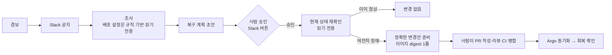

# URL Shortener AI Ops

URL 단축 플랫폼의 운영 증거 검증, 규칙·AI 조사, 제한된 복구 제안과 검증 코드를 관리하는 독립 저장소다. 기존 `f-lab-edu/F-Lab-DevOps`의 AI 경로 이력을 보존해 분리했다. 비공개 저장소이며 원문 비밀값·개인 사건 백업·Terraform state는 포함하지 않는다.

- [AI 구성·기능·검증 범위](ai-ops/README.md)
- [플랫폼 연결·재설치 전환 절차](integration/README.md)
- [현재 작업 인계](HANDOFF.md)
- [추출 경로·원본/분리 commit 대응](docs/repository-extraction.json)

## 장애 대응 워크플로 한눈에 보기 (2026-11-25)

경보가 오면 봇이 조사하고 복구안을 만든다. **사람이 승인한 범위만** 다음 단계로 넘어가고, 봇은 실제 변경 직전에 멈춘다.



| 단계 | 상태 |
|---|---|
| 경보 공지, Slack 조사 요청, 복구 계획, 승인 버튼, 재확인, 변경안(diff) 준비 | 구현·시험 완료. **실환경 검증 전** |
| "이미 정상" 판정(5가지 확인, Ready 60초 지속) | 구현·시험 완료. 실환경 검증 전 |
| 재시작 명령 | 승인·재확인·"실행 조건 충족" 알림까지만 한다. **실제 실행은 꺼져 있다** |
| PR 자동 발행·병합·동기화, 원복 | 봇이 하지 않고 사람이 한다. 자동 발행은 선택 과제 |
| 실환경 전 구간 검증(WF11) | [합격 기준표 초안](ai-ops/docs/wf11-acceptance-sheet-draft-20261125.md)대로 진행 예정. 인프라 재설치 결정 대기 |

**1인 운영 참고.** 현재 Slack 승인 권한은 1명이고, 계획을 요청한 사람만 승인할 수 있다. 그래서 요청자와 승인자 사이의 업무 분리는 없다. 운영자가 2명 이상이 되면, 쓰기 단계(PR 생성·명령 실행·원복)는 요청자가 아닌 지정 승인자가 승인하게 하는 것이 설계 방향이다.

실제 변경을 막는 장치는 다음과 같다.

- 봇에게 쓰기 권한이 없다.
- 사람이 정확한 head를 리뷰하고 CI를 통과시켜야 병합된다.
- GitHub 환경 승인은 UI에서만 한다.

상세 인계는 [WF12 인계 문서](ai-ops/docs/wf12-recovery-handoff-20261124.md)에 있다. 운영 중 장부 상태는 `python -m ai_ops.recovery_status --store <store>`로 조회한다(읽기 전용).

## 로컬 검증

```sh
python3.13 -m venv .venv
.venv/bin/python -m pip install --require-hashes --only-binary=:all: -r ai-ops/requirements.lock
PYTHONPATH=ai-ops/src .venv/bin/python -m unittest discover -s ai-ops/tests -p 'test_*.py' -v
```

배포 정의 통합 검사는 Helm·Ruby와 고정된 플랫폼 chart 소스가 필요하다. `AI_OPS_PLATFORM_SOURCE_ROOT`를 `integration/platform-source.json`의 정확한 commit checkout으로 지정하고 `PYTHONPATH=ai-ops/src .venv/bin/python ai-ops/scripts/check_deployment.py`를 실행한다. 자동 CI는 이 공개 의존성을 고정 SHA로 읽는다. 코드 작성·단위 시험에는 AWS 인프라가 필요하지 않다.

## 저장소 분리 당시 상태 (기록)

최신 진행 상태는 위 "장애 대응 워크플로 한눈에 보기"와 [HANDOFF](HANDOFF.md)를 따른다. 새 main은 기존 main(PR155)에서 추출했다. 원본 PR156의 미병합 변경은 `codex/c04-request-time-20261112`의 별도 검토 대상으로 이관한다. C04 실환경 성공과 C05 최종 완료는 미완료다. 새 live 장애·모델 호출·Terraform은 이관 과정에서 실행하지 않는다.

운영 배포 workflow와 원문 사건·로컬 키·state는 플랫폼/개인 보존 위치에 유지한다. 새 저장소의 권한·Secret·OIDC를 자동 확대하지 않는다. 기존 플랫폼 저장소의 AI 복사본은 실행 연결 전환까지 보존한다. 옛 기록의 상대 경로와 commit/PR 번호는 원본 monorepo 기준이며, 새 코드 변경은 이 저장소에서 관리한다.
