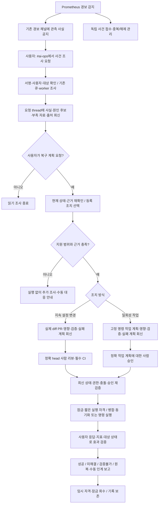

# 장애 공지·조사·복구 워크플로우와 개선 계획

2026-11-18 KST. 코드 기준 AI main `36a55fdb59ec63c34cd7bcb339cada39ec0b515b`. 현재 상태는 코드와 기존 HANDOFF의 배포·검증 기록을 대조했다. 이 문서를 작성하며 클러스터·Slack을 새로 조회하거나 연결하지 않았다. **이 문서는 설계안이며 실행 권한·정책·시간 제한을 변경하지 않는다.**

## 0. 왜 변경하는가 — 배경과 설계 결정

문서 관리 기준: 이 문서는 **배경·목표·설계의 기준**, [구현 작업표](incident-workflow-implementation-tracker.md)는 **작업 상태·검증·다음 행동의 기준**이다. HANDOFF에는 이 두 문서의 위치와 최신 결정만 연결한다. 코드 구현·CI/main 반영·배포·실환경 검증을 서로 다른 완료 상태로 기록한다.

### 사용자 요구와 현재 불일치

| ID | 변경 이유와 확인 근거 | 선택한 방향 또는 제안 | 기대 효과와 대가 | 구현 작업 |
| --- | --- | --- | --- | --- |
| R1 | 사용자는 먼저 장애 사실을 알고, 요청한 경우 조사 결과를 받기를 원한다. 현재는 일부 경보에서 사용자 요청 없이 조사 큐가 생성된다 | 공지와 조사 시작 정책을 분리. 요청 우선 기본 및 선택적 자동 조사 예외는 권고안 | 불필요한 조사와 사용자 혼동 감소. 요청을 늦게 하면 당시 증거가 소실될 수 있어 보관/시점 정책 필요 | WF-01, WF-02, WF-04 |
| R2 | 경보 채널과 #ai-ops가 다르고, 조사 요청이 최초 경보와 자동 연결되지 않는다 | 채널은 보존하고 사건 ID·발생 회차·원본 통지 참조로 연결하는 안 | 대상/사건 혼동 감소. 메시지 참조와 전달 장부 구현 필요 | WF-01, WF-03, WF-04 |
| R3 | 조사 결과 회신은 실제 검증됐지만 Slack 복구 요청은 연결되지 않았다 | 조사 요청·복구 계획 요청·실행 승인을 구분 | 사용자가 무엇이 실행되는지 이해. 승인/상태 관리 추가 필요 | WF-05, WF-06, WF-07 |
| R4 | 기존 복구 구현은 이미지 digest PR 사례에 한정된다. 모든 대응이 Git 변경은 아니다 | 지속 설정 변경은 PR, 일회성 운영 작업은 승인된 고정 명령 작업 | 조치에 맞는 절차 제공. 실행기/권한/검증을 종류별로 구현해야 함 | WF-07, WF-08 |
| R5 | 사람은 즉시 리뷰하지 못할 수 있다. 007은 짧은 실습 기한에서 실제 안내까지14.331초 부족했다 | 사람 대기와 실행/관찰 기한을 분리 설계. 현행 실습 숫자는 변경하지 않음 | 늦은 승인 처리 가능. 대기 후 재검증·만료/갱신 처리 필요 | WF-06, WF-09, WF-11 |
| R6 | PR 생성·명령 성공·경보 해제는 실제 회복의 충분한 근거가 아니다 | 대상 상태·사용자 응답·관련 지표로 효과 판정, 불확실한 결과 명시 | 거짓 성공 방지. 조치별 검증/실패 처리 정의 필요 | WF-07, WF-08, WF-09 |
| R7 | C04 성능 개선과 반복 실습이 핵심 Slack 사용 흐름보다 앞서 진행됐다 | 공지→요청 조사→회신을 먼저 완성하고 복구를 단계 확장 | 사용자 가치와 완료 범위를 명확히 관리. C04/C05 미완료는 별도로 남음 | WF-04, WF-10, WF-11 |

### 확정된 요구와 아직 제안인 선택

- 사용자 요구: 먼저 장애 사실 공지, 요청 시 조사·근거 회신, 복구 요청 시 PR/명령 두 방식까지 포함한 계획 관리. 현재 경보 채널과 조사 채널이 다르다는 사용자 확인.
- 현재 제약: 조사와 쓰기 실행 권한 분리, 기존 승인·원복·실습 기한 보존, C04/C05 미완료와 실제 지원 범위 공개.
- D1 제안: 일반 조사 기본 manual, 자동 조사는 명시적 예외. 기존5종 자동 조사를 즉시 모두 끄기로 확정한 것은 아니다. P1에서 정책/마이그레이션안을 구체화한다.
- D2 제안: 두 채널 유지와 사건 ID 연결. 알림 채널 자체를 조사/승인 채널로 확대하는 것은 별도 선택이다.
- D3 미정: 명령 계획 승인 UI·승인자 정책·유효기간. 서명된 Slack interactivity 또는 인증 화면을 비교해 구체안을 결정한다.
- D4 미정: 일반 운영의 대기·실행·관찰 상한과 보관 기간. 사례별 기준을 정하며 기존 C04 숫자 변경으로 대체하지 않는다.
- D5 제안: 최초 지원은 기존 격리 이미지 PR 복구와 격리 재시작 명령1종. 운영 전체 지원·DB 복원·자유 shell은 이번 초기 범위에 넣지 않는다.

검토한 대안: 모든 경보 자동 조사는 사용자 요청 우선 경험과 맞지 않아 기본안으로 권하지 않는다. 채널 즉시 통합은 기존 권한/알림 설정 변경이 커서 초기안에서 제외한다. 모든 작업을 PR로 만드는 방식은 일회성 명령 승인 표현에 부적합하다. 기존210초 기한만 늘리는 접근은 공지/조사/복구 연결과 사람 대기 문제를 해결하지 못하므로 전체 상태와 시간 정책을 먼저 설계한다.

### 범위와 관리 원칙

이 계획의 첫 배포 가능한 완료 단위는 **기존 경보와 같은 사건에 대한 사용자 조사·결과 회신 연결**이다. 복구는 PR1종, 명령1종 순서로 확장한다. 공지 전송이 실패하더라도 사건 접수 상태를 보존하고, 전송불명확을 무조건 재전송하지 않는다. 원래 경보 시점의 증거가 없으면 현재 조사와 구분해 보고한다. 확장 지원 여부는 경보 이름의 개수가 아니라 검증된 조치·대상·전제조건으로 표시한다.

현재 미재현 과거 오류는 진행을 막는 조건으로 삼지 않는다. 현재 실패나 필수 안전 조건 불충족이 확인되면 해당 작업에 실패 근거와 재현 조건을 기록한다. 신규 기능/조치/권한을 추가하려면 이유·영향·완료 기준과 의존 작업을 작업표에 먼저 추가한다. 계획 작성만으로 외부 실행 승인이 생기지 않는다.

## WF-01 후속 구체화 · 2026-11-18

[사건 ID·두 채널·조사 정책 상세 계약](incident-identity-channel-policy-contract-20261118.md)을 작성했다. D1은 manual 기본+명시적 자동 예외, D2는 두 채널 유지+alert_ref/evt 연결을 로컬 구현 설계로 채택했다. 아래 최초 제안 기록에서의 미확정 상태는 이 구체화로 갱신하며 실환경 정책 적용은 아직 하지 않았다. 현재 변경은 문서뿐이고 다음은 WF-02 로컬 계약·저장 구현이다.

## WF-02/03 구현 상태 갱신 · 2026-11-18

WF-02는 [PR #30](https://github.com/joungGo/url-shortener-ai-ops/pull/30)과 main9c9f3fc CI를 통과했다. WF-03은 기존 공지와 별도 사건 접수의 라우팅 후보·안전한 사실 템플릿·나노초 참조·인증 수신/unknown 상태를 로컬 구현·검증했다. [WF-03 기록](incident-notice-local-20261118.md), [작업표](incident-workflow-implementation-tracker.md)를 최신 상태 기준으로 사용한다.

원본 Slack message ts나 history 권한 없이 사건 참조로 연결한다. 기존 장부를 재사용하고 수신 성공을 Slack 전달 성공으로 기록하지 않는다. 실제 배포 설정은 그대로이며 새 Slack 사건 명령은 WF-04다. WF-03 코드 검토·CI/main과 실제 연결은 아직 하지 않았다. 아래 최초 현행/제안 설명은 설계 작성 당시 상태이며 실제 운영 정책을 변경한 기록이 아니다.

## 1. 목표와 현재 차이

사용자가 원하는 기본 경험은 **장애 사실을 Slack에 먼저 공지 → 사용자가 조사 요청 → 기존 큐·worker가 조사 → 근거와 한계를 Slack으로 회신 → 필요한 경우 별도로 복구 요청 → 계획 검토·승인 → 실행·검증·결과 회신**이다.

현재 경보 채널과 조사 채널 `#ai-ops`는 다르다는 사용자 확인을 현재 구성 사실로 기록한다. 동일 채널·동일 스레드로 통합은 아직 합의된 변경이 아니며 자동 수행하지 않는다. 초기 개선안은 두 채널을 보존하면서 사건 ID와 메시지 링크로 연결하는 방식이다. 알림 채널에서 직접 조사/복구 요청을 허용하려면 별도 채널 권한과 어댑터 연결 검토가 필요하다.

| 항목 | 현재 구현·검증 범위 | 추가 작업 |
| --- | --- | --- |
| 경보 공지 | Prometheus 규칙→Alertmanager→기존 Slack Webhook 설정. Watchdog는 heartbeat, 억제 규칙에 따라 일부 통지는 생략. 이번에 현재 전달을 재검증하지 않음 | 사건 ID·원래 시각·대상·관측 사실·조사 방법 안내, 실제 수신 연계 검증 |
| 자동 조사 | `ai_ops=enabled`·허용 경보5종·등록 대상·인증 조건을 만족한 새 firing 경보를 기존 큐에 등록, 중복 억제·해제 상태 저장 | 사용자 요청 우선 정책으로 전환할지 확정·구현. 기본 권고는 요청 시 조사, 선택적 자동 조사는 명시적으로 활성화한 대상으로 제한 |
| 사용자 요청 조사 | Slack 서명·사용자/채널/대상 확인→영속 inbox→TaskService/JobQueue→worker→같은 요청 thread 회신. 실제 Slack 경로 검증 기록 있음 | 최초 경보와 조사 요청의 사건 연결, 짧은 요청/사건 지정 UI, 접수·진행·실패 상태 안내 |
| 조사 내용 | 읽기 수집·규칙 분석·로그/지표/배포/CI 이력·런북 검색/출처·partial 설명 구현 | 사건 원래 시각과 현재 시각을 구분한 결과, 장시간 경과 시 재수집·유효성 표시 |
| 자동 조사 결과 Slack 전달 | 결과 저장은 구현, 최초 경보 thread로 전달하는 통합 경로는 완료 검증되지 않음 | 자동 조사 유지 시 회신 목적지·권한·중복 전송 장부를 별도로 연결 |
| Slack 복구 요청 | `investigate`만 수신. `recover`·실행 승인·취소는 연결되지 않음 | 명시적 복구 계획 요청과 조회·취소·실행 승인 연결 |
| PR 복구 | 격리 `ai-ops-lab/lab-api` 이미지 digest 변경안·App 권한분리·정확head 리뷰/CI·병합/동기화·검증 경로 구현 | Slack 연결·사건 수명주기·일반 운영 대기 정책, C04/C05 최종 실환경 검증. 운영 전체 복구 지원 아님 |
| 명령 복구 | 일반 실행 기능 없음. 기존 조사 worker에 임의 명령 실행 권한 없음 | 고정 작업 목록·실행기·최소 권한·작업 승인·대상 재확인·감사/재시작/실패 처리 구현 |
| 공통 보호 | 실습 Lease·현재 UID/설정 비교·ACK·임시 자격 회수·한정 원복 기능 존재 | 운영 작업에 맞는 공통 계약으로 추출·어댑터별 적용 검증. 기존 실습 코드를 그대로 범용 실행기로 사용하지 않음 |

현재 Slack 실제 조사 경로는 규칙 기반이다. 모델 관련 코드는 존재하지만 자유로운 AI 추론/유료 모델 호출이 이 경로에서 완료 검증됐다고 주장하지 않는다. `partial`을 없애는 것 자체를 목표로 삼지 않고 관측 범위·불확실성을 정확히 전달한다.

## 2. 목표 전체 흐름

선택적 자동 조사는 기본 흐름과 별도 정책이다. 유지하기로 한 경우에만 사건 접수에서 조사 큐로 분기한다. 공지는 분석 완료를 기다리지 않고 독립적으로 보낸다. 자동 조사 성공/실패가 사람 알림을 막아서는 안 된다. 시스템의 도구/API 수락은 사람이 읽었다는 증거가 아니다.

### 공지·조사 메시지 예시

- 경보: `INC-예시 · lab-api · HTTP 오류율 임계 초과 · 최초 관측 시각 · 현재 firing. 원인은 아직 확인하지 않았습니다. #ai-ops에서 사건 ID로 조사 요청할 수 있습니다.`
- 조사 접수: `INC-예시 조사 작업 접수. 아직 분석 완료가 아닙니다.`
- 조사 결과: `현재 확인한 사실 / 원인 후보와 근거 / 확정하지 못한 사항 / 조사 시각·자료 범위 / 런북 문서 ID·버전·해시·절 위치 / 권장 다음 단계`.
- 복구 계획: `대상 / 선택한 조치 / 근거 / 변경 범위 / 예상 영향 / 실행 전제 / 효과 검증 / 실패 시 행동 / 승인 대상 ID·유효기간`.

자연어 해석이 가능해져도 의도가 불명확하면 대상·사건을 확인한다. 질문 속 “고쳐줘”를 실행 승인으로 사용하지 않는다. 사건 ID·메시지 링크는 서버의 사건 기록과 대조하고, 사용자가 임의 URL·다른 대상·다른 작업으로 바꿀 수 없게 한다. 경보 본문의 설명문을 명령으로 취급하지 않는다.

## 3. 자동 조사 기준과 전환안

현재 허용 목록은 `HighErrorRate`, `CacheHitRateLow`, `CacheOperationErrorHigh`, `DBQueryLatencyHigh`, `APIRequestLatencyHigh`다. 심각도나 AI 판단으로 임의 분기하는 것이 아니다. 이 목록에 있어도 라벨·등록 Target(cluster/namespace/workload/service/environment)·허용 route/operation·발신자 인증을 모두 통과해야 한다. 기본 chart `monitoring.aiOps.enabled`는 false이고 실제 overlay 활성화는 별도다. 현재 실물 활성화 상태는 이 문서만으로 확정하지 않는다.

권고 정책은 대상별 `manual`을 기본으로 두고, 필요할 때만 `automatic`을 명시적으로 허용하는 것이다. 기존 자동 조사 경로는 코드·시험 재료로 재사용하며 삭제/비활성화 적용은 후속 구현 범위에서 결정한다. 자동 조사 결과가 충분히 최신이고 같은 사건/대상에 결합돼 있다면 사용자 요청 시 근거와 시각을 보여 주며 재사용할 수 있다. 오래됐거나 다른 상태면 새 조사를 수행한다. 관련 없는 경보를 같은 사건으로 합치지 않는다.

## 4. PR 방식

지속할 설정의 기준이 Git인 경우 사용한다. 초기 지원 후보는 기존 격리 앱의 정상 이미지 digest 변경이다. 애플리케이션 소스 코드를 매번 수정한다는 뜻은 아니며 Helm values 등 운영 설정 변경도 포함한다.

1. 등록된 조치의 전제조건과 최신 증거를 확인한다. 대상 UID·현재 이미지·정상 이미지 출처·저장소·경로를 결합한다.
2. 허용 파일/필드만 변경한 PR을 만들고 실행 영향·검증·실패 행동을 설명한다. 조사 worker와 모델에는 쓰기 권한을 부여하지 않는다.
3. Slack에 요약·PR 링크를 회신한다. 현재 격리 경로는 별도 App과 정확head 리뷰·CI를 사용한다. 기존 branch 보호는 정상 경로에서 우회하지 않는다.
4. 사람이 해당 head를 승인하고 CI가 통과한 뒤 base·head·diff·대상·승인 만료·충돌을 다시 확인한다. 새 커밋이 생기면 새head 리뷰가 필요하다.
5. 제한된 병합/동기화 주체가 검증한 merge revision만 적용하고 실제 이미지·준비 상태·사용자 응답·관련 지표를 확인한다.
6. 실패 시 사전에 승인한 조건의 후속 조치만 수행한다. Git 변경을 임의로 되돌리거나 별도 정상 digest를 즉석에서 고르지 않는다. Git revert/새 diff도 승인 정책과 원복 계획에 따라 처리한다.

PR 존재/merge 성공/Argo Healthy 중 하나만으로 장애 해결을 선언하지 않는다. 지원 범위를 넘어서는 DB·네트워크·노드·Terraform 변경은 이 이미지 복구 경로에서 실행하지 않는다.

## 5. 명령 실행 방식

일회성 운영 작업에는 설정 diff가 없을 수 있으므로 PR 생성을 강제하지 않는다. **작업 계획 자체가 승인 대상**이다. 초기 후보는 별도 검증을 거친 격리 Deployment의 통제된 재시작이며, 아직 구현되지 않았다.

| 계약 | 계획에 포함할 내용 |
| --- | --- |
| 작업 식별 | action ID·버전·계획 해시·사건/조사 결과 참조 |
| 대상 | 고정 cluster/namespace/workload·현재 UID/revision·허용 컨테이너 |
| 실행 | 서버에 등록한 작업과 검증된 인자만 사용. 임의 shell·사용자 자유 명령·모델 생성 문자열 실행 금지 |
| 승인 | 실행할 정확한 계획·대상·유효기간·실행자와 승인자 권한을 결합. 일반 Slack 텍스트만으로 승인 처리하지 않음 |
| 영향 | 예상 중단·가용 replica/배포 상태·다른 운영자/HPA/GitOps와의 충돌 |
| 검증 | API 응답과 실제 대상 상태·사용자 경로·관찰 조건 |
| 실패 | 중단·재조회·승인된 원복·수동 인계 중 하나를 조치별로 정의 |

Slack 승인 UI는 인증된 interactivity 또는 별도 인증 승인 화면 중 구체 경로를 구현 단계에서 선택하고, 승인자의 권한을 검증한다. 같은 승인 이벤트 재전송은 실행을 반복하지 않는다. 실행 직전 대상 UID·설정·권한이 바뀌면 중단하고 필요한 경우 새 계획/승인을 요청한다. 짧은 실행 자격과 허용 작업별 권한을 사용하며 kubectl 전체 권한을 조사 worker에 부여하지 않는다.

재시작은 이전 프로세스로 되돌릴 수 없으므로 “모든 명령을 자동 원복”한다고 약속할 수 없다. 재시작 실패 시 무한 반복하지 않고 적용 여부·현재 상태를 조회해 인계한다. 응답 유실 등으로 쓰기 적용 여부가 불명확하면 다시 실행하지 않고 `needs_review`로 격리한다. 일시적인 replica 변경도 HPA/GitOps 소유권에 따라 PR 방식이나 소유 컨트롤러 경로를 사용해야 한다.

## 6. 공통 상태·시간·승인·실패 정책

새 제안 상태는 공지(`pending/delivered/uncertain`), 경보(`firing/resolved`), 조사, 복구 계획, 승인, 실행, 효과 검증을 각각 분리한다. 예를 들어 경보가 resolved여도 사람이 계획을 승인했거나 복구 효과가 검증됐다는 뜻은 아니다.

복구 상태 흐름은 `requested → planning → awaiting_approval → revalidating → executing → verifying → succeeded / unresolved / verification_unknown`를 기본으로 한다. 실행 전에는 `rejected/cancelled/expired/superseded`로 끝날 수 있다. 실행 중 취소는 다음 단계를 중단하는 요청이며 이미 적용된 변경을 지우지 않는다. 승인된 원복은 별도 결과로 기록해 최초 실패를 덮어쓰지 않는다. 현재 실습 상태기계와 새 제안 상태기계는 후속 구현에서 명시적으로 매핑한다.

### 장시간 사람 대기

- Slack 공지는 조사나 사람 리뷰를 기다리지 않는다. 관측 조건·평가주기·통지 지연은 별도로 표시한다. 모든 종류의 클러스터 장애를 즉시 탐지한다고 보장하지 않는다.
- 조사/계획 작성, 사람 대기, 실제 실행, 효과 관찰의 시간을 분리한다. 일반 운영에서는 사람이 한 시간 이상 뒤에 확인하는 상황을 지원하는 설계가 필요하다.
- 대기 중에는 큐 장부와 계획만 영속 보관한다. 클러스터 잠금·긴 쓰기 토큰을 점유하지 않는다. 재시작 후 같은 사건/작업/PR과 연결하며 중복 생성을 막는다.
- 계획·승인·증거에는 유효기간이 있다. 대기 후 대상과 증거를 다시 조회하고, 의미 있는 diff/대상/조치 변경 시 새 계획을 만들고 재승인받는다. 오래된 승인으로 상태가 바뀐 클러스터에 쓰지 않는다.
- 대기 중 자연 회복되면 다시 확인해 `already_recovered` 등으로 종료하고 불필요한 변경을 하지 않는다. 새 장애 회차는 새 사건으로 연결한다.
- 일반 운영의 대기 상한·실행 timeout·효과 관찰·에스컬레이션은 조치별 서비스 목표와 위험을 바탕으로 확정해야 한다. 이 문서에서 임의의 새 숫자를 적용하지 않는다.

### 기존 실습 기한 보존

현재 C04 Lease3초·시작15초·안내 뒤 최소리뷰120초·시작 뒤 리뷰마감210초·소유원복 목표240초·독립원복 시작300초·관찰120초와 실행별 새readiness 승인·정확head 사람리뷰·CI·잠금·ACK·자격회수를 유지한다. 이 문서는 시간 연장 승인이나 새 실습 승인이 아니다.

실습은 의도적으로 만든 장애의 지속 시간을 제한하고 미리 승인된 정상 상태로 돌아오도록 설계됐다. 일반 운영에서 사람 대기가 길다는 이유만으로 임의 원복하면 안 된다. 자동 원복은 해당 조치의 원복 대상·조건·기한·권한이 사전에 승인됐을 때만 가능하다. 명령의 가역성 여부도 따로 확인한다.

PR29/main36a55fd의 응답 포장·안내25초 예약은 반영됐지만 기록된007 전체 경로14.331초 부족은 해결 완료가 아니다. C04/C05는 미완료로 보존한다. 제품 흐름 구현과 실습 성능 개선을 구분하고, 새 실습을 자동 반복하지 않는다.

## 7. 재사용·변경·추가 구현

| 구분 | 구성 | 방향 |
| --- | --- | --- |
| 재사용 | Prometheus/Alertmanager Slack 알림·Watchdog | 사람 알림을 조사와 독립적으로 보존 |
| 재사용 | Slack HMAC/허용 사용자·채널·대상, inbox·전송 장부 | 사건/작업 식별과 신규 의도별 인가 확장 |
| 재사용 | TaskService/JobQueue·worker·IncidentStore·로그/지표/이력·런북 출처 | 조사·결과의 기준으로 유지. 쓰기 작업은 별도 실행기 |
| 재사용 | PR 작성/병합 신원 분리·정확head 리뷰/CI·diff 제한·현재상태 비교 | 지원 PR 조치별 어댑터로 재사용. 현재 고정lab 범위를 무단 일반화하지 않음 |
| 변경 | 경보가 직접 자동 조사 큐를 만드는 정책 | 요청 우선 기본과 대상별 자동 조사 옵션으로 명시화 |
| 변경 | 조사 요청이 원래 경보와 분리된 상태 | 사건 ID·발생시각·원본 메시지/대상 연결 추가 |
| 추가 | 복구 계획/승인/실행 장부와 Slack 의도 처리 | `조사`, `복구안 준비`, `승인`, `조회`, `취소`를 분리 |
| 추가 | 명령 작업 목록·실행기·정책·승인 UI | 고정 작업만 최소권한으로 수행, 실행불명확/재시작 중복 방지 |
| 추가 | 일반 운영 장시간 대기 정책 | 승인 만료/갱신·상태 변경·이미 회복·충돌 처리 |
| 추가 | 공통 결과·회복 검증·실패/원복 통지 | 전달 성공·사용자 읽음·승인·실행·회복을 구분 |

## 8. 구현 순서와 완료 기준

| 단계 | 작업 | 인프라 없이 할 일 | 연결 후 확인할 일 | 완료 기준 |
| --- | --- | --- | --- | --- |
| P1 | 사건·채널·조사 정책 계약 | 사건 ID/회차·두 채널 연결·요청우선/선택자동·보관 정책 | 실제 라벨/수신 채널·알림 지연 확인 | 공지/조사/복구 상태와 권한이 구분되고 운영자 설정에 명시됨 |
| P2 | 공지→조사→결과 연결 | 합성 경보와 서명 Slack 이벤트로 전체 경로·재전송/재시작/해제/실패 검증 | 승인 범위의 통지와 새 사용자 조사 요청·같은 사건 결과 회신 | 사용자 요청 전 조사가 기본 시작되지 않고 원래 경보와 결과가 연결됨 |
| P3 | 공통 복구 계획·대기 장부 | 계획해시·등록 조치·승인·만료·늦은 리뷰·취소·재검증·중복 시험 | 실제 승인 주체/권한·상태 충돌 조회 | 미승인/만료/변경된 계획은 쓰기0, 대기 중 쓰기토큰/잠금0 |
| P4 | Slack→기존 PR 복구 연결 | 이미지 조치만 연결, 가짜 GitHub/Argo로 diff/리뷰/CI/실패·재시작 시험 | 검증된 격리 대상에서 별도 승인 후 PR/동기화·효과 확인 | 정확head 승인·CI·현재상태 조건을 통과한 변경만 실행, 결과 Slack 연결 |
| P5 | 명령 복구 최초1종 | 격리 재시작 후보의 실행 계약·별도 실행기·가짜 API·불명확 쓰기/재실행 거절 | 별도 승인된 대상·최소권한으로 명령·응답/효과 검증 | 승인 계획과 실제 작업/대상이 일치, 중복 실행0, 실패 후 무한 재시작0 |
| P6 | 통합 검증·문서 | 각 경로 회귀·기한/승인/권한/회수 계약·설치/정리 인계 | 공지/조사/PR/명령 실제 통합과 C04/C05 남은 필수 검증 | 성공·미해결·검증불가·취소·원복 결과와 제한사항을 사실대로 기록 |

**다음 구현 추천은 P1→P2**다. 핵심인 공지·사용자 조사·결과 연결을 먼저 완성하고 P3→P4→P5로 확장한다. 초기 지원 조치를 이미지 복구와 명령1종으로 한정하며, DB 복원·데이터 변경·노드/네트워크·임의 shell을 완료 범위에 끼워 넣지 않는다. 새 조치는 별도 전제·권한·승인·검증/실패 절차가 마련된 뒤 등록한다.

실환경 단계는 해당 실행의 승인 범위를 확인한 뒤 수행한다. 이 계획 작성으로 설치·유료모델·Slack 전송·명령/복구·장애 주입을 승인받았다고 해석하지 않는다. 현재 재현되지 않는 과거 문제는 최종 구현보다 앞세워 반복 조사하지 않는다.

## 9. 현재 근거와 남은 결정

현재 코드 근거:
- [경보 허용·큐 접수](../src/ai_ops/alerts.py)
- [경보 라우팅 계약](../src/ai_ops/alert_routing.py)
- [Slack 조사 입력·회신](../src/ai_ops/slack_adapter.py), [Slack Web API](../src/ai_ops/slack_web.py)
- [공통 조사 작업](../src/ai_ops/tasks.py), [기존 worker](../src/ai_ops/worker.py)
- [고정 이미지 변경안](../src/ai_ops/c_recovery.py), [기존 PR 준비 실행기](../scripts/prepare_c4_recovery_pr.py)
- [기존 C 설계](C1-approval-recovery-design.md), [안내 응답 검토](C4-notice-tool-roundtrip-review-20261118.md)

위 예전 설계의 당시 저장소/형식/진행 상태는 역사적 기록이며 현재 상태는 최신 HANDOFF와 실제 계약을 우선한다. 플랫폼 소스는 `cluster-addons/prometheus/values.yaml`과 `url-shortener/url-shortener-chart/templates/prometheusrule.yaml`을 대조했다. 실제 코드 소유권은 [integration 계약](../../integration/README.md)을 따른다.

구현 전 확정할 결정은 자동 조사 기본/예외 정책, 사건을 지정하는 Slack 입력 표현, PR 방식의 검증된 실행 트리거, 명령 승인 UI와 승인자 정책, 작업별 대기/만료/효과 검증 시간, 최초 명령1종의 대상이다. 본 문서의 요청우선·두채널 연결·이미지복구+재시작 후보는 권고안이며 실제 설정을 자동 변경하지 않았다. 새 작업 때 P1에서 선택안을 코드 계약과 검증 가능한 입력으로 구체화한다.

작성 결과: 문서와 HANDOFF만 추가/갱신. 코드·기존 정책·시간·권한·연결 변경 없음. 추천 모델/추론 깊이: **GPT-6 SOL · High**.

## WF-02 로컬 구현 인계 · 2026-11-18

사건 저장·기존 큐 연결·7일 상세 보관/최소 해시 장부·검증된 legacy 전환을 로컬 구현했다. [WF-02 상세 기록](incident-store-local-implementation-20261118.md)과 [작업표](incident-workflow-implementation-tracker.md)를 따른다. 사건 장부·outbox 코어와 기존 worker 연결까지이며 HTTP/Slack 어댑터·주기 정리 연결은 WF-03/04에서 이어간다. 이전 절의 미구현 표시는 당시 계획이며 현재 상태는 작업표로 판단한다. CI/main·배포·실환경 검증은 별도 단계다.

## 2026-11-19 WF-06 로컬 계약 구체화

[승인 대기·재검증 구현](recovery-approval-local-20261119.md)을 기준으로 D3/D4를 분리했다. D3는 초안의 PR 준비 동의(prepare_proposal)와 정확한 PR head/완성 명령의 실행 승인을 구분한다. 이번 장부는 전자만 구현하며 자연어 승인·자동 명령 실행을 지원하지 않는다. 서명된 Slack interactivity는 후속 연결안이고 실제 인증/권한 연결 없이 actor 문자열을 승인 입력으로 공개하지 않는다.

D4는 사람 대기·승인 유효·관측 신선도·재검증 기한을 별도 필수 설정으로 만들고 기존 자료 보관 기한으로 제한한다. 합성 시험 시간은 운영 기본값이 아니다. 실행/관찰 시간과 실제 UI 활성화는 조치별 WF07~09에 남긴다. 기존 C04/C05 기한·새 실행 승인·사람 리뷰·원복 조건은 그대로다. WF06 로컬 핵심 완료가 일반 장애 복구 또는 실환경 검증 완료를 의미하지 않는다.

## 2026-11-19 WF-07 계획·승인에서 이미지 PR 연결

[WF07 로컬 구현](recovery-pr-local-20261119.md)은 같은 사건/job/계획을 기존 이미지 PR 계약과 연결한다. 준비 동의와 정확 head의 실행 리뷰를 분리하고, 정상 이미지·최소 diff·사람 리뷰/CI·별도 실행 신원·현재상태·잠금 검사를 재사용한다. PR 생성 결과가 불명확하면 자동 재생성하지 않고 조회로 조정한다. PR 병합·Argo 동기화·서비스 회복도 각각 별도 상태다.

현재는 로컬 fixture 작성과 쓰기 비활성 merge/sync 계획·검증 코어다. Slack 승인 인증/결과 outbox 및 생산용 쓰기·잠금 획득/회수 포트는 활성화하지 않았다. WF09 효과 검증과 기존 draft DB 보관 정리도 후속 연결 목록에 둔다. C04의 짧은 실습 기한은 변경하지 않고 일반 사람 대기는 기존 PR/근거 신선도 계약으로 관리한다. 로컬 코어 완료를 실환경 복구 완료로 해석하지 않는다.

## 2026-11-19 WF-08 명령 방식의 로컬 계약

[WF08 명령 구현](recovery-command-local-20261119.md)에서 D5의 최초 후보를 격리 단일 Pod Deployment 재시작으로 한정했다. 저장된 Unhealthy/비준비 Pod 근거만으로 원인을 확정하지 않고, 별도 현재 진단·충돌/가용성 조건·정확한 PATCH 계획 승인을 요구한다. D3의 execute_command 승인과 prepare_proposal 동의를 같은 수명주기·다른 장부/정책으로 관리한다. D4의 사람 대기와 짧은 실행/관측 기한은 별개이며 테스트의 시간은 운영 기본값이 아니다.

실제 shell이나 Kubernetes 호출 대신 로컬 fixture 포트로 실행 순서·한 번만 소비·CAS·잠금·불명확 결과의 읽기 조정·취소를 검증한다. 재시작은 비가역이므로 자동 원복을 약속하지 않고 수동 인계한다. 적용 확인과 서비스 효과는 분리하며 후자는 WF09다. 실제 Slack 승인/전송·RBAC/자격·실행 포트는 연결하지 않았고 기존 C04/C05 조건은 변경하지 않았다.

## 2026-11-19 WF-09 효과·후속·회수의 로컬 계약

R5/R6의 적용과 회복 구분을 [WF09 로컬 구현](recovery-effect-local-20261119.md)으로 구체화했다. 기존 PR/명령 적용 기록과 새 관찰 구간을 연결하고 성공/미해결/검증불가·취소·원복 결과·회수 확인을 별도 보존한다. 원복은 정확한 기존 승인 범위/기준선/기한을 확인한 후보만 제시하며 새 실행 권한을 발급하지 않는다. 재시작은 수동 인계하고 자동 반복하지 않는다.

D4의 일반 운영 기본 시간·D3의 인증된 승인 UI를 새로 활성화하지 않았다. 합성 필수 설정은 최소120초 관찰과 읽기15초/Lease3초 안에서 시험하며 C04/C05 조건을 변경하지 않는다. 회수 완료는 신뢰된 소유 manifest의 확인 범위이고 운영 자원 전체 정리 주장이 아니다. 실제 수집/승인/쓰기/회수 adapter·Slack 전송과 실환경 검증은 WF10/11 후속이다.

## WF-10 연결 계획 구체화 · 2026-11-19

[연결 계획](wf10-connection-plan-20261119.md)과 검토용 입력 작업표를 추가했다. 최신 WF02~09 main 반영을 기준으로 공지/조사 첫 완료단위를 먼저 검증하고 실제 복구 실행 연결은 분리한다. 위 흐름도도 공지가 사건 서버 성공을 기다리지 않는 독립 경로로 바로잡았다. 경보채널 ID/source registry/새 image·manifest·DB원복/정상CI는 적용 전 확정한다. 새 빈 큐·manual기본/자동예외0개는 실제 적용 전 승인할 전환안이다. 현재는 계획 문서완료이며 실행/정책 변경은 없다. 기존 시간·승인·원복 조건 유지.

## WF-10 비활성 준비 갱신 · 2026-11-19

[비활성 설정·전환/원복 자료](wf10-disabled-preparation-20261119.md)를 로컬 준비했다. 하나의 store 안에 큐/사건 DB와 Slack inbox DB가 별도임을 전환/보존 단위에 반영했다. 기존 Helm은 enabled=false로 리소스0, Slack도 disabled로 자격사용0이며 실제 연결 renderer/입력과 승인 전에는 활성화할 수 없다. 실제 코드/배포 전환이나 정책 적용은 아니다.

## WF-10 활성 설정 로컬 구현 · 2026-11-19

[활성 후보 설정](wf10-active-config-local-20261119.md)을 별도 모듈로 준비했다. render 입력과 사후 실제 준비/승인 조건을 분리하며 실제 미확정 값에는 리소스를 생성하지 않는다. 단일 Pod/기존 PVC·자격 분리 제안, 접수기 설정 hash 호환을 로컬 검증한다. 실제 배포·연결/실습은 미수행이다.
