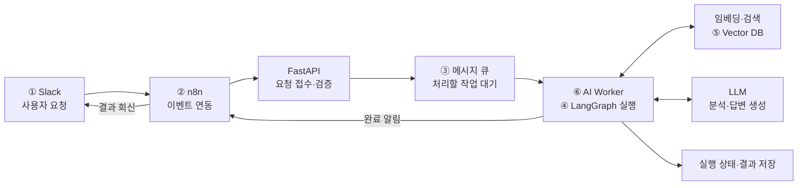
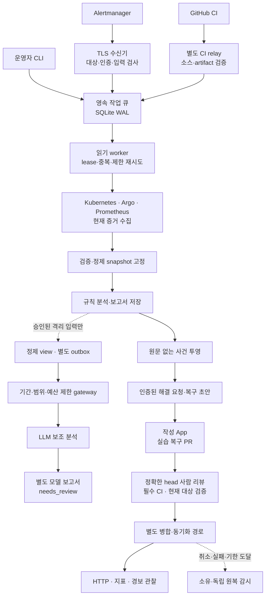

# 영상의 AI 서비스 아키텍처와 프로젝트 비교

- 기록일: 2026-11-12 KST
- 영상: [이력서에 AI 내용 이거 복붙하세요](https://www.youtube.com/shorts/EjcI5zW52gk)
- 1장은 앞선 설명을 문구 그대로 보존했다. 2장 이후는 현재 프로젝트와의 비교 및 개선 제안이다.
- 프로젝트 비교 상태 기준: 2026-11-12 22:55 KST. 코드에 구현된 기능과 실환경 완료 판정을 구분한다.

## 1 앞선 영상 분석 원문

**이 구조는 “비동기 작업 처리 백엔드에 검색·LLM·상태 기반 흐름 제어를 결합한 AI 서비스 아키텍처”입니다.** 요청 접수와 오래 걸리는 AI 처리를 분리한다는 점에서 실무적인 구조입니다. 다만 **Slack·n8n·FastAPI·LangGraph라는 제품 조합 자체가 모든 서비스의 표준인 것은 아닙니다.** 널리 활용되는 것은 그 안의 설계 원칙입니다.

[영상](https://www.youtube.com/watch?v=EjcI5zW52gk&t=30s)의 자동 생성 한국어 자막과 첨부 그림을 대조했습니다. 아래에서는 영상에서 설명한 흐름과, 제가 운영 설계 관점에서 보완한 내용을 구분해서 설명하겠습니다.

먼저 영상의 흐름은 다음과 같습니다. 결과 저장·회신 경로까지 풀어서 그렸습니다.



**사용자는 Slack에 메시지 하나를 남기지만, 서버에서는 하나의 작업을 접수하고 추적하며 처리하는 시스템이 움직이는 것입니다.** 그림의 각 박스가 반드시 별도 서버여야 한다는 뜻은 아닙니다.

각 구성요소의 책임을 구분하면 이해하기 쉽습니다.

| 구성요소 | 맡는 역할 | 구분할 점 |
|---|---|---|
| **Slack** | 사용자가 요청하고 결과를 받는 인터페이스 | AI 처리 엔진이 아니라 입출력 창구 |
| **n8n** | Slack 이벤트 수신, 데이터 변환, API 호출, 알림 등 서비스 연동 | 외부 서비스들을 연결하는 업무 흐름 |
| **FastAPI** | 요청 형식·권한을 검증하고 작업을 접수하는 API | 오래 걸리는 AI 처리를 요청 응답 안에서 끝낼 필요가 없음 |
| **메시지 큐** | 접수한 작업을 worker에게 전달하고 대기 요청을 흡수 | 작업 전달과 처리량 조절을 담당 |
| **Worker** | 큐에서 작업을 가져와 실제 처리 | AI 호출·검색·도구 실행이 일어나는 실행 주체 |
| **LangGraph** | worker 안에서 단계·분기·반복·중단·재개를 관리 | 어떤 순서로 무엇을 실행할지 관리 |
| **임베딩·Vector DB** | 질문과 관련된 문서를 검색 | 답변에 사용할 외부 지식을 공급 |
| **LLM** | 질문 해석, 분류, 분석, 답변·변경안 생성 | 출력의 정확성과 실행 권한은 별도 검증 필요 |

여기서 가장 중요한 설계 선택은 **요청을 받는 일과 요청을 처리하는 일을 분리한 것**입니다.

예를 들어 LLM 응답에 30초가 걸리는데 Slack 요청을 받은 서버가 그동안 응답하지 않으면 문제가 생깁니다. Slack Events API는 3초 안에 수신 응답을 요구하며, 응답하지 않으면 재전송할 수 있습니다. Slack 공식 문서도 빠른 응답과 큐를 통한 후속 처리를 안내합니다. 따라서 수신 계층은 빠르게 접수 사실을 응답하고, 실제 작업 결과는 나중에 Slack 메시지로 보내는 방식이 적합합니다. [Slack Events API 문서](https://docs.slack.dev/apis/events-api/#responding-to-events)

이때 다음 세 가지는 서로 다른 상태입니다.

- Slack에 보낸 **수신 확인**: 이벤트를 받았다는 뜻
- FastAPI의 **작업 접수 응답**: 처리할 작업을 등록했다는 뜻
- worker의 **작업 완료**: 실제 결과를 만들었다는 뜻

접수 성공을 처리 성공으로 기록하면, 사용자는 “완료됐다는데 결과가 없다”는 상황을 겪게 됩니다.

FastAPI에서 `async`를 사용한다고 이 문제가 모두 해결되는 것도 아닙니다. `async`는 입출력 대기를 효율적으로 처리하는 방법이고, **프로세스 재시작 후 작업 복구·다른 서버로의 작업 분배·재시도 정책**은 별도의 설계입니다. FastAPI 공식 문서도 여러 프로세스나 서버에서 처리할 작업에는 큐 기반 도구를 고려하도록 설명합니다. [FastAPI Background Tasks](https://fastapi.tiangolo.com/tutorial/background-tasks/#caveat)

**n8n과 LangGraph가 둘 다 있는데, 역할이 겹치지 않느냐는 질문이 생길 수 있습니다.**

이 구조에서는 두 도구의 책임을 다음처럼 나누는 것이 자연스럽습니다.

- **n8n:** “Slack에서 들어온 요청을 어느 API로 보내고, 처리 결과를 어디에 알릴까?”
- **LangGraph:** “이 질문은 검색이 필요한가? 어떤 도구를 호출할까? 근거가 부족하면 어떻게 할까? 사람의 승인을 기다려야 하나?”

즉, n8n은 **서비스 사이의 연결**, LangGraph는 **AI 작업 내부의 처리 흐름**을 담당합니다. LangGraph는 공유 상태·노드·분기로 흐름을 구성하고, 코드로 정한 단계와 LLM이 판단하는 단계를 함께 배치할 수 있습니다. [LangGraph 공식 개요](https://docs.langchain.com/oss/python/langgraph/overview)

예를 들어 worker 내부 흐름은 이렇게 만들 수 있습니다.

```text
요청 분류
  → 필요한 자료 수집
  → 관련 문서 검색
  → LLM 분석
  → 결과 형식·근거 검사
  → 정보 부족: 추가 질문
  → 조회 요청: 답변 전달
  → 변경 요청: 사람 승인 대기
```

다만 처리 흐름이 단순하다면 일반 Python 코드로도 충분합니다. n8n에서도 모든 일을 할 수 있는 작은 서비스에 FastAPI·별도 worker·LangGraph를 전부 추가하면 운영할 대상만 늘어날 수 있습니다. **각 도구가 분리해서 맡을 책임이 분명할 때 이 구성이 설득력을 갖습니다.**

또 하나 주의할 점은, **그림의 메시지 큐와 n8n 자체의 queue mode를 구분해야 한다는 것**입니다. n8n도 자체적으로 Redis와 worker를 이용해 *n8n 워크플로우 실행*을 분산할 수 있습니다. 그림처럼 FastAPI 뒤에 별도 큐가 있다면, 그것은 *AI 작업 실행*을 위한 또 다른 큐일 수 있습니다. 둘을 함께 사용한다면 재시도와 상태 관리가 두 계층에 걸치므로 책임을 정해야 합니다. 영상에서는 Redis도 언급하지만, 정확히 어느 역할을 맡는지는 상세히 구분하지 않습니다. [n8n queue mode 문서](https://docs.n8n.io/deploy/host-n8n/configure-n8n/scaling/enable-queue-mode.md)

**RAG 부분은 “문서를 준비하는 과정”과 “질문에 답하는 과정”으로 나눠 봐야 합니다.**

문서를 준비할 때는 보통 다음 과정이 필요합니다.

```text
문서 수집 → 적절한 길이로 분할 → 임베딩 생성 → 문서·벡터·출처 정보 저장
```

질문에 답할 때는 다음 과정이 움직입니다.

```text
질문 → 질문 임베딩 → 관련 문서 검색 → 질문과 검색 내용을 LLM에 전달 → 답변
```

임베딩 모델은 텍스트를 검색 가능한 숫자 벡터로 바꾸고, 답변 생성 모델은 질문과 검색 자료를 읽어 결과를 만듭니다. **검색 자료를 제공하는 것과 모델 자체를 재학습시키는 것은 다른 일입니다.** 또한 RAG는 기존 검색 API나 데이터베이스 조회로도 구성할 수 있어, 별도 Vector DB가 언제나 필수인 것은 아닙니다. [검색·임베딩·RAG 공식 설명](https://docs.langchain.com/oss/python/deepagents/retrieval)

DevOps 사례로 보면 차이가 명확합니다.

| 필요한 정보 | 적합한 출처 |
|---|---|
| 과거 장애 대응 방법, 배포 절차, 운영 규칙 | 문서 검색·RAG |
| 현재 Pod 상태, 배포 revision, 최근 오류율 | Kubernetes·배포 시스템·모니터링 API |
| 두 자료를 연결한 원인 설명과 대응안 | LLM 분석 |

예전 장애 문서에서 “DB 연결 문제였다”는 내용을 찾았다고 해서 **현재 장애도 DB 문제라고 확정할 수는 없습니다.** 현재 관측과 문서상의 지식을 구분해서 모델에 제공해야 합니다.

그림의 LLM 박스가 두 개라는 이유만으로 멀티 에이전트 구조가 되는 것도 아닙니다. 모델별 역할 분담이나 대체 호출을 표현했을 수 있지만, 영상만으로 구체적인 호출 정책까지 확정할 수는 없습니다. 전체 경로를 코드가 정하면 AI 워크플로우에 가깝고, LLM이 상황에 따라 도구와 처리 경로를 선택하면 에이전트 성격이 강해집니다. Anthropic도 이 기준으로 둘을 구분합니다. [워크플로우와 에이전트의 구분](https://www.anthropic.com/research/building-effective-agents)

**큐가 있다고 요청 100개를 동시에 처리할 수 있는 것은 아닙니다.**

그림의 “100개 요청”은 대기 요청을 쌓아둘 수 있다는 의미로 읽는 것이 적절합니다. 동시 처리 수가 5라면 worker는 대기 작업 중 최대 5개를 처리하도록 구성할 수 있습니다. worker를 늘려도 LLM 제공자의 요청·토큰 제한이나 외부 API 제한에 걸리면 처리량은 더 늘지 않을 수 있습니다.

따라서 운영할 때는 CPU뿐 아니라 **큐 대기 시간, 처리 중 작업 수, 모델 호출 제한, 작업당 토큰·비용, 전체 처리 시간**을 함께 봐야 합니다.

영상은 전체 개념을 설명하기 위한 그림이라, 실제 운영에 필요한 다음 요소들은 생략돼 있습니다. 아래는 제 설계 검토입니다.

| 필요한 보완 | 빠졌을 때 생기는 문제 | 설계할 내용 |
|---|---|---|
| **작업 상태 저장** | 재시작 후 무엇을 처리했는지 알 수 없음 | 접수·실행·승인 대기·성공·실패·취소 상태와 결과 저장 |
| **중복 처리 방지** | 재전송된 요청으로 알림·외부 변경이 반복됨 | 이벤트 ID·작업 ID 기준 중복 접수 및 실행 제어 |
| **재시도·실패 격리** | 한 작업이 무한 재시도하거나 큐를 막음 | 재시도 가능한 오류 분류, 횟수·기한 제한, 실패 작업 격리 |
| **검색 권한·최신성** | 다른 사용자의 문서나 오래된 절차를 답변에 사용 | 사용자별 접근 권한, 문서 버전·출처·갱신 관리 |
| **모델·도구 실행 제한** | 잘못된 판단이 실제 시스템 변경으로 이어짐 | 허용 도구·대상·인자 검증, 필요시 사람 승인 |
| **추적·품질 평가** | 느리거나 틀린 결과의 원인을 찾기 어려움 | 동일 작업 ID로 단계별 지연·오류·토큰·검색 근거 추적 |
| **결과 전달 관리** | 작업은 끝났지만 Slack 회신만 유실됨 | 결과 저장과 알림 상태 분리, 회신 실패 복구 |

여기서 **Vector DB, 작업 상태 DB, LangGraph 체크포인트는 서로 다른 책임**입니다.

- Vector DB: 답변에 참고할 지식을 찾습니다.
- 작업 상태 DB: 사용자에게 보여줄 접수·완료 상태와 결과를 관리합니다.
- 체크포인트: 그래프가 어느 단계까지 진행됐는지 저장합니다.

물리적으로 같은 데이터베이스에 구성할 수는 있지만, 용도를 구분해야 합니다. LangGraph도 체크포인트와 장기 저장을 구분하며, 메모리에만 저장한 체크포인트는 재시작 후 유지되지 않습니다. [LangGraph 영속성 문서](https://docs.langchain.com/oss/python/langgraph/persistence)

또한 **체크포인트가 있다고 외부 작업이 자동으로 정확히 한 번 실행되는 것은 아닙니다.** 승인을 기다렸다가 노드를 재개하거나 실패한 노드를 다시 실행하면, 그 안의 API 호출이 반복될 수 있습니다. LangGraph 공식 문서도 이러한 부수 효과에 중복 실행 방지가 필요하다고 설명합니다. 배포·결제·삭제처럼 실제 상태를 바꾸는 작업에서는 특히 중요합니다. [중단·재개 시 부수 효과 처리](https://docs.langchain.com/oss/python/langgraph/interrupts#side-effects-called-before-interrupt-must-be-idempotent)

**DevOps/SRE 관점에서는 “분석”과 “변경 실행”의 경계를 가장 중요하게 봅니다.**

예를 들어 Slack에 “배포 후 오류가 늘었어. 확인해 줘”라는 요청이 들어왔다면 다음 흐름이 적절합니다.

1. 요청자와 조회 권한을 확인합니다.
2. 현재 배포·로그·지표를 읽습니다.
3. 관련 운영 문서를 검색합니다.
4. LLM이 관측 근거와 가설, 대응안을 만듭니다.
5. 변경이 필요하면 정확한 대상과 변경안을 승인받습니다.
6. 제한된 실행기가 허용된 변경만 수행합니다.
7. 실제 서비스 회복을 검증한 뒤 결과를 회신합니다.

Slack 서명 검증은 요청이 Slack에서 왔는지 확인하는 수단입니다. **그 사용자가 운영 환경을 변경할 권한이 있는지는 별도로 검사해야 합니다.** 마찬가지로 RAG에서 찾은 문서는 판단 자료이지 실행 권한이 아닙니다. [Slack 요청 검증 문서](https://docs.slack.dev/authentication/verifying-requests-from-slack/)

이 관점에서 영상의 메시지는 타당합니다. AI를 개발 보조 도구로 사용하는 경험에서 더 나아가, **사용자 요청을 받아 검색·추론·처리·결과 전달까지 연결하는 서비스 구성요소로 설계해 보라는 뜻**입니다.

이력서에서 설명할 때도 도구 이름을 나열하는 것에 더해, 다음을 실제 근거로 설명할 수 있어야 설득력이 생깁니다.

- 왜 API와 worker를 분리했는가?
- 중복 요청·worker 재시작·모델 실패를 어떻게 처리했는가?
- 어떤 자료와 권한 범위에서 AI가 판단했는가?
- 처리 시간·비용·답변 품질·복구 결과를 무엇으로 검증했는가?

다음 설계 검토 추천: **GPT-6 SOL · High**.

## 2 현재 AI 운영 시스템과 비교

### 비교 기준과 핵심 판단

영상의 구조와 우리 시스템은 **요청 접수와 오래 걸리는 처리를 분리하고, worker가 근거를 읽어 결과를 저장한다는 점에서 같은 계열**이다. 우리 시스템의 목적은 운영 증거 조사와 승인 기반 복구이므로, 범용 대화 서비스보다 **자료 출처·현재 대상·변경 권한·실행 기한·실패 시 원복**을 더 구체적으로 다룬다.

반면 영상이 강조하는 Slack 사용자 창구, n8n 연동 편집, 임베딩 기반 문서 검색은 현재 AI 경로의 중심 구성요소가 아니다. 해당 제품이 없다는 이유로 비동기 처리나 상태 관리가 빠져 있는 것은 아니다. 우리 시스템은 그 책임의 상당 부분을 Python 코드, 엄격한 계약, 영속 저장소로 구현했다.

비교 기준은 공개 main `9573b8c9f323a643e65bb58c323dc932c681a6b2`의 구현과 2026-11-12 22:55 KST 인계 기록이다. 추가로 읽은 작업트리의 HEAD는 `d29f534c84204dd2875d4f61766febd8df868e80`였으며, 시간 경계 보완과 로컬 문서의 후속 내용은 main 검증 결과와 구분한다. 이는 특정 시점의 아키텍처 비교이며 이후 실습의 완료 상태를 자동으로 갱신하는 문서는 아니다.

### 영상 아키텍처 이미지와 흐름


1. **요청 접수:** 사용자가 Slack에 요청하면 n8n이 이벤트를 받아 FastAPI로 전달한다. FastAPI는 입력을 검증하고 작업 큐에 접수한다. 이때의 접수 응답은 AI 분석이 완료됐다는 뜻이 아니다.
2. **비동기 처리:** AI Worker가 큐에서 작업을 가져온다. worker 내부의 LangGraph가 필요한 단계와 분기를 관리하며, 문서가 필요하면 임베딩·Vector DB로 검색하고 LLM으로 분석·답변을 생성한다.
3. **저장과 회신:** worker가 결과를 저장한 뒤 n8n을 통해 Slack에 회신한다. 그림 아래쪽의 n8n·Slack은 위쪽과 같은 구성요소를 결과 전달 경로에서 다시 표시한 것이며, 별도 서비스를 하나씩 더 설치한다는 의미는 아니다.

핵심은 **빠른 요청 접수와 오래 걸리는 AI 처리를 분리**하는 것이다. 검색 자료는 답변의 근거이고, 큐는 대기 작업을 전달하는 장치다. 둘 다 모델 출력의 정확성을 자동으로 보장하지는 않는다.

### 우리 프로젝트 아키텍처 이미지와 흐름


1. **접수와 조사:** 경보·CI·운영자 입력을 각 접수 경로에서 검증해 SQLite 영속 큐에 넣는다. 읽기 worker는 Kubernetes·Argo·Prometheus 및 검증된 CI 근거를 수집하고 snapshot과 규칙 보고서를 저장한다. 중복 방지·lease·재시작 조정이 작업 상태를 관리한다.
2. **선택적 모델 분석:** 승인된 격리 입력만 정제 view와 별도 outbox를 거쳐 모델 gateway로 전달한다. gateway는 승인 범위·기간·예산을 확인하고 LLM 분석을 연결한다. 모델 보고서는 기본 규칙 보고서와 분리해 저장하며, `needs_review` 상태는 사람의 의미 검토가 필요하다는 뜻이다.
3. **승인 후 복구:** 검증된 사건을 바탕으로 인증된 해결 요청과 제한된 이미지 복구안을 만들고, 작성 App이 실습 PR을 생성한다. 정확한 head에 대한 실제 사람 리뷰와 필수 CI, 현재 대상·잠금·기한 검증을 통과해야 별도 병합 주체와 Argo 동기화 경로로 진행한다.
4. **회복 확인과 원복:** 변경 뒤 HTTP·지표·경보를 관찰해 회복 여부를 확인한다. 실패·취소·기한 도달 시에는 확인된 변경과 소유권에 따라 소유·독립 원복 감시가 동작한다. PR 생성, 병합, 동기화, 정상 응답은 각각 별도로 확인해야 하는 상태다.

핵심은 **모델 분석과 변경 실행 사이에 독립된 승인·검증 경계가 있다**는 것이다. 모델 출력이 복구 실행기로 직접 연결되지 않으며, worker의 읽기 권한도 쓰기 권한으로 확대되지 않는다. 그림은 구현 구조를 설명하며 실환경 검증의 완료 상태는 아래 판정 기록과 구분한다.

### 같은 부분과 다른 부분

| 비교 항목 | 영상 아키텍처 | 우리 프로젝트 | 판단 |
|---|---|---|---|
| 목적 | Slack 요청을 처리하는 AI 서비스 | 경보·CI·운영자 요청을 근거로 운영 상황을 조사하고 제한된 복구를 준비 | 처리 원리는 같고 업무 범위가 다름 |
| 입구 | Slack → n8n → FastAPI | CLI, Alertmanager TLS 수신기, GitHub CI 전달기, 인증된 운영자 서비스 | 외부 입력을 검증해 내부 처리로 넘기는 책임은 같음 |
| API 구현 | FastAPI | AI 경로의 수신기는 Python `HTTPServer`, 운영자 서비스는 Unix socket 등 사용 | 웹 프레임워크 선택이 다름. URL 단축 앱의 FastAPI와 AI 수신기를 구분해야 함 |
| 서비스 연동 | n8n 워크플로우 | CI relay, 수집기, 명시적인 Python 연결 코드 | 연동 책임을 코드로 구현 |
| 작업 전달 | 메시지 큐, 구체 제품은 확정되지 않음 | SQLite WAL 기반 `JobQueue`와 영속 PVC | 영속 비동기 접수는 같고 분산 방식은 다름 |
| 처리량 | 그림에 100개 요청, 동시성 정책은 설명되지 않음 | `MAX_WAITING=100`, 저장소별 단일 worker 잠금 | 우리 구현도 100개 동시 분석이라는 뜻이 아님 |
| worker | 큐 소비 후 AI 작업 실행 | 검증 → 읽기 수집 → snapshot 고정 → 규칙 보고서 → 결과 연결 | 실행 주체를 접수 계층과 분리한 점이 같음 |
| 흐름 제어 | LangGraph의 상태·분기 | Python 상태 전이, Pydantic 계약, 큐 lease/generation, 실행 장부와 각종 guard | 상태 기반 흐름 제어는 이미 있음. LangGraph 채택은 별도 선택 |
| 지식 공급 | 임베딩·Vector DB RAG | 등록 런북의 ID·버전·내용 해시 검증과 고정 도구 조회 | 지식을 제공한다는 목적은 같지만 의미 검색은 다름 |
| 현재 상태 수집 | 영상에서 상세히 다루지 않음 | Kubernetes·Argo·Prometheus 및 출처를 검증한 CI artifact | 운영 판단에 필요한 현재 관측을 별도로 수집 |
| LLM | worker의 분석·최종 답변 생성 | 규칙 보고서를 기본으로 하고 승인된 정제 입력에 별도 모델 분석을 연결 | 모델 실패·중단이 기본 규칙 보고서를 무효화하지 않음 |
| 저장 | 결과 저장 언급, 세부 계약은 생략 | 큐 DB, 사건 snapshot/report/audit, 모델 outbox·장부, 복구 요청/초안, 실행 journal | 목적별 상태와 결과를 구체적으로 분리 |
| 사람 승인 | 첨부 개념도에서 구체 정책은 보이지 않음 | 실행별 준비 승인과 정확한 PR head의 실제 사람 리뷰를 구분 | 영상에 없는 것으로 단정할 수는 없지만 우리 구현에서 명시적인 핵심 경계 |
| 변경 실행 | 세부 실행 권한은 설명되지 않음 | 작성·병합 App 분리, values의 이미지 digest 제한, 최신 CI/대상/잠금 검증, 정확한 merge SHA sync | 일반 답변 생성을 넘어 제한된 GitOps 복구를 설계 |
| 실패 처리 | 큐 이후 오류 정책은 상세하지 않음 | 중복·제한 재시도·취소·재시작 조정, 불명확 전송 중단, 소유/독립 원복 감시 | 운영 실패와 안전 중단을 구체적으로 다룸 |
| 회신 | 결과를 Slack에 전달 | 사건/큐 조회, 조사 보고서, 실습 PR 안내와 실행 결과 | 결과는 존재하지만 범용 Slack 대화 UX는 별도 확장 대상 |

구현 근거: [큐][P1], [worker][P2], [경보 수신기][P3], [CI 전달기][P4], [운영자 서비스][P5], [실습 CI 배포 정의][P6], [런북 도구][P7], [모델 실행기][P8], [PR 승인 검증][P9], [실행 장부][P10].

AI 소스·의존성 범위에서 n8n, LangGraph, 벡터 검색 SDK 채택은 확인되지 않았다. Prometheus 응답의 `resultType=vector`는 시계열 조회 형식이며 Vector DB 사용의 증거가 아니다. 프로젝트의 앱용 Redis 역시 그 이름만으로 AI 작업 큐나 RAG 저장소라고 볼 수 없다.

### 우리 시스템의 실제 흐름

다음 그림은 역할을 합쳐 표현한 것이다. 운영 경보 조사와 격리 CI 조사는 대상·자격·저장 경계가 분리되며, 모든 요청이 모든 단계를 거치는 것은 아니다.



모델 보고서에서 복구 실행기로 곧바로 이어지는 화살표를 두지 않은 이유가 중요하다. **현재 제한된 복구는 검증된 이미지 실패 근거와 정해진 변경 계약을 사용한다. 모델이 생성한 자유 문장이나 도구 명령이 실행 권한이 되는 구조가 아니다.** 모델의 보고서 계약 통과 역시 실제 원인이 맞다는 의미나 사람 승인과 동일하지 않다. [worker 모델 연결][P2], [복구 요청·초안][P11], [PR 승인 검증][P9]

### 이미 구현한 기능을 새로 추가할 필요는 없다

앞선 영상 분석에서 운영 보완으로 제시한 항목 중 상당수는 우리 프로젝트에 이미 있다.

- **중복 방지와 영속 상태:** 동일 키·동일 입력은 같은 작업으로 연결하고, 키는 같은데 내용이 달라지면 거절한다. CI 입력은 run/attempt·artifact·설정 등의 결합을 검증한다.
- **재시작 처리:** worker는 고정 snapshot과 저장 보고서를 대조해 큐 상태를 조정한다. 재시작 때 현재 자료로 과거 입력을 조용히 바꾸지 않는다.
- **제한 재시도와 취소:** 큐에는 최대 시도 수, lease 소유권, 취소와 검토 대기 상태가 있다. 실패 상태 관리와 별도 메시지 브로커의 DLQ는 같은 구현이라고 주장하지 않는다.
- **자체 관측:** 큐 상태별 건수, 가장 오래 기다린 작업의 나이, 만료 lease, worker 진행 시각과 단계별 관측 코드가 있다.
- **모델 비용·전송 통제:** 모델 캠페인, 정제 view, outbox와 비용 장부가 있다. 전송됐는지 불명확하면 무조건 재전송하지 않고 검토 상태로 멈춘다.
- **변경 권한 통제:** 실제 신원·정확한 PR head·필수 CI·단일 허용 diff·대상·잠금과 현재 조건을 확인한다.
- **중단·원복 준비:** 취소와 확인된 외부 변경을 실행 장부에 기록하고, 실패 시 원복 경로를 준비한다.

따라서 “영상처럼 만들려면 큐·중복 방지·승인 기능을 처음부터 추가해야 한다”는 평가는 맞지 않는다. 추가할 부분은 기존 기능의 부족한 사용자 경험·확장성·검증 범위를 구체적으로 좁혀야 한다. [큐][P1], [worker 관측][P12], [모델 장부][P13], [실행 장부][P10]

### 큐와 LangGraph가 다른 이유

우리 `JobQueue`는 같은 저장소에서 worker 한 개가 처리하도록 제한한다. 실습 CI 정의는 1GiB ReadWriteOnce PVC를 사용한다. 이는 작은 조사 시스템에서 동작과 복구를 추적하기 쉬운 선택이지만, 여러 노드의 worker가 독립적으로 소비하는 분산 브로커와 같은 구조는 아니다. **Pod 재시작 뒤 자료가 남는 것과 노드·가용 영역 장애에도 즉시 계속 처리하는 고가용성은 구분해야 한다.** 큐의 100개 대기 상한과 최대 3회 시도는 코드의 정책이고 처리량 측정 결과가 아니다. [큐][P1], [배포 정의][P6]

LangGraph는 이러한 큐를 자동으로 대체하지 않는다. 우리 큐는 작업을 접수·소유·완료시키고, LangGraph는 한 작업 내부의 흐름과 상태를 구성하는 데 쓸 수 있다. 현재는 그 내부 흐름도 명시적인 Python 코드로 관리한다.

기존 큐 snapshot·모델 outbox·복구 초안·실행 journal에 LangGraph 체크포인트까지 추가하면 같은 사건의 상태가 여러 저장소에 퍼질 수 있다. 도입한다면 **각 상태의 기준 저장소, 재개 가능한 단계, 외부 쓰기의 중복 방지**부터 정해야 한다. 읽기 조사 흐름에 먼저 적용 가능성을 평가하고, 복구 승인·권한 검사와 쓰기 실행기는 독립적으로 유지하는 편이 적절하다. [LangGraph 영속성](https://docs.langchain.com/oss/python/langgraph/persistence), [부수 효과 재실행 주의](https://docs.langchain.com/oss/python/langgraph/interrupts#side-effects-called-before-interrupt-must-be-idempotent)

### 현재 구현과 완료 판정을 구분하기

2026-11-12 22:55 KST 기록 기준, 공개 main 기준선의 로컬 시험은 **870개**이며 PR 검사 4종이 통과한 기록이 있다. 후속 시간 경계 보완은 **880개 로컬 시험**이 통과한 것으로 별도 문서에 기록돼 있다. 두 수치를 같은 main 검증 결과로 합치지 않는다.

최근 실습은 실제 장애 주입과 사건 접수 뒤, 보존된 관측 시각이 해결 요청 시각보다 약 2초 늦어 새 복구 PR 생성 전에 중단됐다. 정상 원복·HTTP 200·잠금 해제·임시 자격 회수는 확인됐지만, **그 실행에서 사람 리뷰를 거친 새 PR 병합·동기화와 C-04 회복 관찰이 성공한 것은 아니다.** 시각 순서를 엄격히 검사하는 정책이 작동한 것이며, 이를 성공시키기 위해 검사를 풀거나 요청 시각을 소급하는 방식은 적절하지 않다.

또한 A5의 HolmesGPT 동등 조건 품질 비교, A7의 사람 독립 의미 채점·수동 분석 기준선은 별도 미측정 범위다. 기능 시험 개수나 안전한 원복 성공을 AI 진단 정확도·MTTR 단축률·비용 절감률로 바꿔 표현할 수 없다. 이 비교에서 해당 평가를 기존 합의 범위의 새 완료 차단 조건으로 추가하지는 않는다.

상태 근거: [HANDOFF 기록](/Users/jounghyeon/dev/Url-Shortener-EKS-Platform/HANDOFF.md), [현재 최종 검증 대조 문서](/Users/jounghyeon/dev/Url-Shortener-EKS-Platform/.worktrees/c05-final-report/ai-ops/docs/C5-final-validation-20261112.md). 문서는 이후 변경될 수 있으므로 위 판정은 명시한 기준 시점에 한정한다.

## 3 우리 프로젝트에 추가하면 좋은 부분

### 우선순위 1 기존 복구 흐름의 실환경 검증과 단계별 시간 분석

현재 가장 먼저 얻을 가치는 새 프레임워크보다 **승인된 복구 흐름을 끝까지 검증하고 지연·거절 원인을 확인할 수 있는 근거**다.

이미 단계 기록과 안전한 거절 진단이 있으므로 이를 활용해, 같은 실행에서 준비·수집·사건 접수·요청 생성·PR 생성·안내·리뷰 확인·병합·sync·회복 관찰에 걸린 시간을 연결해 보여주는 요약을 보강하면 좋다. 이후 반복 표본이 충분할 때 p50/p95를 산출하고, 한 번의 실습 시간을 장기 성능으로 일반화하지 않는다.

특히 관측 시각·수집 시각·요청 시각·실제 안내 완료 시각을 분리해 표시하고, 호스트별 시계 오차는 읽기 측정으로 확인해야 한다. 승인·리뷰·원복 마감 검증을 느슨하게 하는 대신, 어느 단계에서 시간이 소모됐는지와 현재 조건을 명확히 보여주는 개선이다. 실제 장애 실행에는 기존 실행별 승인을 계속 적용한다.

### 우선순위 2 기존 런북 조회를 출처가 남는 검색으로 확장

현재 `get_runbook(document_id)`는 등록 ID의 문서를 검증해 읽는다. 이는 신뢰할 수 있는 지식 공급 경로이지만 질문에 맞는 문단을 자동으로 찾는 의미 검색과는 다르다. 등록 런북이 캐시·DB·배포의 세 문서인 현재 범위에서는 먼저 다음처럼 확장하는 편이 단순하다.

1. 런북에 증상·서비스·실패 유형·적용 버전의 검색 메타데이터를 추가한다.
2. 고정 키워드나 메타데이터로 관련 문단을 찾고 문서 ID·버전·내용 해시·절 위치를 결과에 남긴다.
3. 등록된 코드 근거의 해시 변경을 감지해 검토 필요 상태를 표시한다. 기존 `live_verified=false`를 새 검증 없이 바꾸지 않는다.
4. 같은 증거 묶음에서 기존 ID 조회와 검색 확장의 답변 품질·오탐·지연을 비교한다.
5. 문서량과 질의 다양성이 늘어 단순 검색의 한계가 확인되면 임베딩·벡터 검색 또는 혼합 검색을 검토한다.

검색 입력과 결과에는 접근 범위·출처·버전·최신성 정보가 필요하다. 문서 속 명령은 근거 데이터로만 다루며, 검색 결과로 허용 도구나 실행 권한을 확대하지 않는다. 또한 현재 외부 모델은 허용 필드만 담은 정제 view를 받으므로 **런북 원문을 그대로 외부 모델에 보내는 확장은 기존 연결과 별개의 데이터 정책 검토가 필요하다.** [런북 도구][P7], [등록 목록][P14], [정제 모델 입력][P15]

추가 후 확인할 지표는 관련 런북을 제대로 찾았는지, 인용 문단이 실제 주장을 지지하는지, 오래된 문서를 제외했는지, 문서가 없을 때 판단을 유보하는지다. Vector DB 설치 자체는 품질 향상의 증거가 아니다.

### 우선순위 3 Slack은 얇은 요청과 결과 창구로 추가

영상에서 사용자 편의에 가장 직접적으로 도움이 되는 부분이다. 예를 들어 `/aiops investigate lab-api`를 입력하면 작업 ID와 접수 상태를 받고, 완료 후 같은 thread에서 요약·근거 참조·보고서 링크를 볼 수 있다.

추천 흐름은 **Slack 서명·요청자/대상 권한 검증 → 빠른 수신 응답 → 기존 접수 계약과 큐 → 기존 worker → 결과 전달 기록 → Slack thread 회신**이다. 읽기 조사부터 시작하고, Slack 메시지의 “승인”이라는 문구를 GitHub의 정확한 PR head 리뷰로 바꾸어 처리하지 않는다.

새 수신기와 기존 내부 큐 사이를 공개 파일 공유나 임의 JSON으로 우회하지 않고, 대상과 인자를 제한하는 접수 어댑터로 연결해야 한다. Slack event ID는 기존 중복 처리와 연결하고 사용자별 요청 상한을 둔다. [Slack 이벤트 처리](https://docs.slack.dev/apis/events-api/#responding-to-events), [서명 검증](https://docs.slack.dev/authentication/verifying-requests-from-slack/)

n8n은 Slack·Jira·메일 등 여러 연동을 자주 바꾸는 요구가 생기면 유용하다. Slack 한 경로만 추가할 때는 직접 어댑터와 비교해 판단할 수 있다. n8n에 복구 자격이나 최종 승인 판단을 맡기기보다 기존 통제를 호출하는 연동 계층으로 제한하는 편이 현재 설계와 맞는다.

### 우선순위 4 결과 생성과 알림 전달 상태를 별도로 보여주기

우리에게는 모델 입력 전달용 outbox와 실습 PR 안내 연결이 이미 있다. 여기에 범용 Slack 창구를 붙인다면 **분석 결과 저장 완료와 사용자에게 알림 전달 완료를 별도로 기록**해야 한다. 모델 outbox가 있다고 Slack 알림 재전송까지 해결되는 것은 아니다.

결과는 저장됐지만 Slack API가 실패한 경우, 분석을 다시 실행하지 않고 알림만 복구해야 한다. 사건/run 참조·전달 대상·메시지 식별자·시도 상태를 결합하고, 응답을 잃은 불명확 전달은 먼저 확인하도록 설계한다. 외부 API에 대한 무조건적인 exactly-once 보장은 피한다. 실제 PR 안내가 늦어 리뷰 시간을 확보하지 못하면 시작을 중지하는 기존 정책도 유지한다.

### 우선순위 5 도구 추가 전 동등 입력으로 품질 비교

새 검색이나 LangGraph를 도입할 때 다음 세 방식을 같은 증거와 접근 권한으로 비교하면 선택 이유를 설명하기 쉽다.

| 비교 방식 | 확인할 내용 |
|---|---|
| 기존 규칙 분석 | 현재 기준선의 설명·오탐·판단 유보 |
| 규칙 + 검증된 문서 검색 + 모델 | 검색이 실제 근거와 진단 품질을 개선하는지 |
| 제한된 도구 탐색 모델 | 고정 입력보다 필요한 자료를 잘 고르고 추가 지연·비용을 감수할 가치가 있는지 |

기존 평가 자료와 코드가 있으므로 새로운 평가 체계 전체를 다시 만들 필요는 없다. 사람 독립 채점, 인용의 의미상 지지, 정상 오탐, 정보 부족 시 유보, 처리 시간과 비용을 보강하면 된다. 개선에 사용한 입력은 새 최종 평가의 미노출 자료로 다시 주장하지 않는다. 실제 비교 실행이나 유료 모델 호출은 이번 문서 작성에 포함하지 않는다.

### 조건이 생길 때 검토할 항목

| 항목 | 도입을 검토할 조건 | 함께 해결해야 할 문제 |
|---|---|---|
| LangGraph | 조사 분기·반복·중단/재개가 많아져 현재 코드의 관리 비용이 커짐 | 기존 저장소와 체크포인트의 책임, 재개·외부 쓰기 중복, 보안 경계 |
| 분산 메시지 브로커 | 단일 worker 처리량이나 복구 시간이 요구 수준에 미달하고 다중 소비자가 필요함 | visibility/lease, 중복, backoff, 실패 격리, 취소, 순서, 보고서 commit 조정 |
| 별도 Vector DB | 문서량·검색 품질 요구가 커져 메타데이터/키워드 검색으로 부족함 | 권한 필터, 색인 버전, 삭제 반영, 재색인, 임베딩 비용·외부 전송 |
| n8n | 비개발자도 변경해야 하는 여러 업무 연동이 생김 | 자체 queue mode와 AI 큐의 재시도 책임, 자격 관리, 배포·업그레이드 |
| FastAPI | 외부용 API 스키마·동시 접수·인증 통합과 운영 표준화 요구가 커짐 | 기존 검증 정책 보존, 인증/인가, 제한, 중복 접수, 작업 접수와 완료 구분 |

특정 제품을 모두 추가하는 것보다 **현재 기능의 끝단 검증 → 근거가 남는 검색 → 필요한 사용자 창구 → 측정된 병목에 대한 확장** 순서가 이 프로젝트의 목적에 맞다. 이 문서는 비교와 제안이며 새로운 설치·실습 실행을 승인하거나 기존 구현 완료 조건을 변경하지 않는다.

## 4 구현 근거

아래 코드 링크는 비교 기준 main SHA로 고정했다. 현재 진행 상태는 앞서 적은 시점의 인계 기록과 구분한다.

| 근거 | 역할 |
|---|---|
| [job_queue.py][P1] | 영속 접수·대기 100개 상한·시도·중복·lease |
| [worker.py][P2] | 수집·snapshot·보고서와 보조 모델 경로 분리 |
| [alert_receiver.py][P3] | 경보 TLS 수신 |
| [ci_relay.py][P4] | CI 발견·원본 검증·별도 전달 |
| [c_operator.py][P5] | Unix socket 기반 인증된 운영자 요청 경로 |
| [ci_service.py][P6] | 격리 CI worker/relay·1Gi PVC·읽기 권한 정의 |
| [replay_tools.py][P7] | 등록 런북·해시·고정 도구 검증 |
| [model_runtime.py][P8] | 매 전송 전 캠페인·실제 조건 검증 |
| [c_approval.py][P9] | 실제 리뷰·정확한 head·diff 검증 |
| [c_execution_control.py][P10] | 취소·외부 변경 시도/확인·실행 장부 |
| [c_recovery.py][P11] | 사건 투영·해결 요청·제한 복구 초안 |
| [worker_runtime.py][P12] | worker 실행·큐 지표·보관 정리 |
| [continuous_model.py][P13] | 모델 outbox·캠페인·영속 장부 |
| [runbooks/index.yaml][P14] | 문서 ID·버전·해시·정적 검증 범위 |
| [model_ci_projection.py][P15] | CI 증거의 제한된 외부 모델 입력 |
| [pyproject.toml][P16] | AI 패키지 의존성 |

[P1]: https://github.com/f-lab-edu/F-Lab-DevOps/blob/9573b8c9f323a643e65bb58c323dc932c681a6b2/ai-ops/src/ai_ops/job_queue.py
[P2]: https://github.com/f-lab-edu/F-Lab-DevOps/blob/9573b8c9f323a643e65bb58c323dc932c681a6b2/ai-ops/src/ai_ops/worker.py
[P3]: https://github.com/f-lab-edu/F-Lab-DevOps/blob/9573b8c9f323a643e65bb58c323dc932c681a6b2/ai-ops/src/ai_ops/alert_receiver.py
[P4]: https://github.com/f-lab-edu/F-Lab-DevOps/blob/9573b8c9f323a643e65bb58c323dc932c681a6b2/ai-ops/src/ai_ops/ci_relay.py
[P5]: https://github.com/f-lab-edu/F-Lab-DevOps/blob/9573b8c9f323a643e65bb58c323dc932c681a6b2/ai-ops/src/ai_ops/c_operator.py
[P6]: https://github.com/f-lab-edu/F-Lab-DevOps/blob/9573b8c9f323a643e65bb58c323dc932c681a6b2/ai-ops/src/ai_ops/ci_service.py
[P7]: https://github.com/f-lab-edu/F-Lab-DevOps/blob/9573b8c9f323a643e65bb58c323dc932c681a6b2/ai-ops/src/ai_ops/replay_tools.py
[P8]: https://github.com/f-lab-edu/F-Lab-DevOps/blob/9573b8c9f323a643e65bb58c323dc932c681a6b2/ai-ops/src/ai_ops/model_runtime.py
[P9]: https://github.com/f-lab-edu/F-Lab-DevOps/blob/9573b8c9f323a643e65bb58c323dc932c681a6b2/ai-ops/src/ai_ops/c_approval.py
[P10]: https://github.com/f-lab-edu/F-Lab-DevOps/blob/9573b8c9f323a643e65bb58c323dc932c681a6b2/ai-ops/src/ai_ops/c_execution_control.py
[P11]: https://github.com/f-lab-edu/F-Lab-DevOps/blob/9573b8c9f323a643e65bb58c323dc932c681a6b2/ai-ops/src/ai_ops/c_recovery.py
[P12]: https://github.com/f-lab-edu/F-Lab-DevOps/blob/9573b8c9f323a643e65bb58c323dc932c681a6b2/ai-ops/src/ai_ops/worker_runtime.py
[P13]: https://github.com/f-lab-edu/F-Lab-DevOps/blob/9573b8c9f323a643e65bb58c323dc932c681a6b2/ai-ops/src/ai_ops/continuous_model.py
[P14]: https://github.com/f-lab-edu/F-Lab-DevOps/blob/9573b8c9f323a643e65bb58c323dc932c681a6b2/ai-ops/runbooks/index.yaml
[P15]: https://github.com/f-lab-edu/F-Lab-DevOps/blob/9573b8c9f323a643e65bb58c323dc932c681a6b2/ai-ops/src/ai_ops/model_ci_projection.py
[P16]: https://github.com/f-lab-edu/F-Lab-DevOps/blob/9573b8c9f323a643e65bb58c323dc932c681a6b2/ai-ops/pyproject.toml

후속 설계·구현 검토 추천: **GPT-6 SOL · High**.
