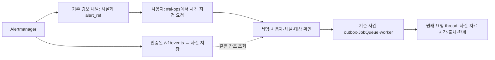

# WF-10 공지·사건 조사 실제 연결 계획 · 2026-11-19

> 후속: [비활성 설정·전환/원복 로컬 준비](wf10-disabled-preparation-20261119.md)를 완료했다. 아래 실행 입력12개는 여전히 미확정이며 활성 배포 패키지가 아니다.

**상태: 문서 준비 완료 / 실행 준비 미완료 / 적용 미승인.** 이번 작업은 코드·과거 검증 기록을 읽어 계획한 것이며 AWS·클러스터·Slack 신원/채널·현재 자격을 조회하지 않았다. 이미지나 실행 manifest를 생성·등록하지 않았다. [입력 작업표](wf10-connection-inputs-20261119.json)는 검토용 inventory이며 runtime 설정으로 읽거나 적용하면 안 된다.

[전체 계획](incident-workflow-and-improvement-plan-20261118.md) · [작업표](incident-workflow-implementation-tracker.md) · [사건/채널 계약](incident-identity-channel-policy-contract-20261118.md) · [WF04 연결](incident-slack-local-20261119.md)

## 1. 첫 완료 범위와 이유

첫 완료단위는 **경보 사실 공지 → 사용자가 사건 지정 조사 요청 → 기존 큐/worker 조사 → 요청한 thread에 같은 사건의 근거·한계 회신**이다. WF02~09의 로컬 구현과 main 반영은 완료됐지만 새 사건 명령·접수/정책·DB를 실제 환경에 연결한 것은 아니다. 기존 일반 Slack 조사 성공을 새 사건 흐름 성공으로 재사용하지 않는다.

이 단위는 WF07~09의 실제 복구 writer 연결을 기다릴 필요가 없다. `plan-recovery` 등 기존 로컬 기능을 실행 권한으로 승격하지 않으며, 이번 연결 검증은 `investigate-event`, `status-event`, 기존 일반 `investigate`의 읽기 조사에 한정한다. 새 복구 승인 endpoint·PR 생성/병합/동기화·명령 실행·효과/자격 회수 어댑터와 C04/C05는 WF11 전 별도 구현·계획·검증 대상이다.

공지는 분석을 기다리지 않는다. 두 수신 경로의 실제 도착 순서는 보장하지 않는다. 사건 접수202를 Slack 공지 수신으로 표시하지 않고, 공지가 먼저 도착해 사건이 아직 없으면 확인 중/조회불가와 조사0을 반환한다. 사용자는 새 메시지로 다시 요청한다. Watchdog·억제·그룹/반복 정책 때문에 모든 원시 firing이 Slack에 개별 공지된다고 약속하지 않는다.

## 2. 고정할 대상·버전·권한

| 항목 | 현재 근거 / 계획 | 실제 연결 전 확인 |
| --- | --- | --- |
| AI 소스 | main `1bea7d6f83e60b12ddb2fe04ce181cfecf5a17ff`, PR37·main CI44462377953 성공 | 이 commit 또는 이후 검토 main을 명시; 이미지 새 빌드/재사용 출처와 digest·실제 코드 일치 |
| 플랫폼 | 마지막 검증 main `bf6bcbc100cc4af47d7aba690db69d80a0a5298b` | 설치 시 최신 승인 main과 변경 diff 재검토; WF03 pin은 별도 유지 |
| WF03 소스 | `integration/wf03-platform-source.json`의 `d6c2c8fca50feb8453948be284e7b9b7cccb5284` | 플랫폼 병합본 template/prepare 파일 동일성, 실제 chart 버전/원본 values 호환 |
| AWS/대상 | 기존 계정764428911194·서울, 등록 별칭 `url-shortener-b6-lab`, 격리 `ai-ops-lab/lab-api` | 새 cluster ID·UID·이미지·binding·실제 서비스, 다른 대상 자동 추가 금지 |
| Slack App | 과거 기록: URL Shortener Investigator, team `T0AAZ9N5GT1`, app `A0CJHH8ULUC` | 승인된 실제 연결에서 기존 자격의 신원·bot user ID 확인; 화면 기록만으로 인증 완료 아님 |
| 조사 채널/요청자 | 기존 `#ai-ops` / `C0CK82SD8NL`, 사용자 `U0ABBAD4FT7` | 현재 팀·채널 참여·사용자 allowlist 대조 |
| 경보 채널 | 기존 Webhook 목적지를 보존하며 조사 채널과 분리 | **정확한 channel ID 미확정**. 비밀 Webhook URL을 문서에 쓰지 않고 기존 설정/사용자 화면으로 확인 |
| 사건 발신원 | source_alias + source_id + cluster_id를 단일 registry로 고정 | **실제 값 미확정**. 합성 `lab-seoul/am-lab/practice-eks-example`을 복사하지 않음. HA replica는 같은 논리 source_id |
| HTTP 수신 | 과거 Slack URL `https://slack-ops.bidservice.store/slack/events` 재사용 후보 | 새 DNS/NLB/TLS/SAN/만료·정확 route 확인. 기존 레코드는 현재 서비스 정상 증거 아님 |
| 자격/권한 | 기존 Slack App·scope·원본 키, 기존 읽기 수집 권한 재사용 | 새 history scope·IAM·쓰기 권한 없이 가능한지 확인; 새 범위 필요 시 구체 diff로 별도 결정 |

이미지 digest·bot ID·실제 경보 channel/source/cluster ID·새 ConfigMap/Secret 이름·정상 CI run은 현재 확정하지 않는다. 준비가 끝날 때 확정된 입력과 manifest/원복 자료 hash를 묶어 실행 승인을 받는다. 과거 설치·Slack 연결·실습 승인을 재사용하지 않는다.

## 3. 재사용할 코드와 준비할 배포 연결

| 구성 | 재사용 / 필요한 연결 |
| --- | --- |
| 플랫폼 경보 | `cluster-addons/prometheus/wf03/prepare.py`로 실제 원본 values의 **검토용 복사본** 생성. 원본의 Watchdog/억제/간격/인증·CA·Webhook 파일/목적지를 보존하며 직접 공지 continue와 ai-events를 분리 |
| 사건 접수기 | `alert_receiver`의 `--cluster-id`, `--event-source-alias`, `--event-source-id`와 `/v1/events`를 같은 registry에 맞춤. 일부 옵션만 지정하거나 같은 프로세스에서 옛 `/v1/alerts`를 병행하지 않음 |
| Slack ingress/relay | `SlackWebConfig.event_sources`를 접수기 registry와 동일하게 렌더. ingress와 relay의 정책·설정/키 identity 동일성 확인. 예시 파일은 disabled 상태 유지 |
| 기존 큐/worker | 별도 조사 큐를 만들지 않고 동일 새 store/PVC·settings/bindings를 공유하는 배치를 준비한다. **현재 namespace/PVC/프로세스 배치 미확정**이며 경로 문자열만 같은 것으로 동일 DB라고 판단하지 않는다. 서로 다른 namespace/PVC이면 재배치·마운트 diff를 별도 검토한다. 읽기 collector·기존 worker를 사용하고 복구 쓰기 권한을 부여하지 않음 |
| 조사 정책 | DB `event_policy`의 revision/config_hash/rules를 확인. 새 저장소 기본 rules=[]를 검증. 변경은 기존 `set_policy(expected_revision=...)` 계약으로만 수행; 임의 JSON policy 파일을 적용하는 절차를 만들지 않음 |
| 결과/보관 | 기존 Slack inbox/outbox, 같은 요청 thread 전송 및 relay의60초 maintenance/event expire 재사용. 실제 호출·보관 범위를 검증하며 WF06~09 장부 prune은 별도 연결 |
| 배포 산출물 | 새 이미지/설정·mount/args·TLS/NetworkPolicy·route·정상 CI source binding의 정제 diff, disabled 렌더와 원복 자료 필요. 현재 문서는 실행 가능한 installer가 아님 |

**정책 전환안:** 수동 조사 기본, 자동 예외0개. 기존 `ai_ops=enabled`→5종 자동조사 분기는 승인된 전환 때 사건 접수로 바꾼다. 이벤트 등록 자체는 조사 권한이 아니며 unbound/conflict/미허용 대상은 조사하지 않는다. 자동 조사 결과의 수신자·전송 연결이 준비되지 않은 상태에서 `delivery_ready=true`나 자동 예외를 켜지 않는다. 이 정책 차이를 최종 적용 승인에 명시한다.

## 4. 보존 자료와 큐 전환

기록상 인프라는 2026-11-19 정리 완료다. 이번에 실물 부재나 백업 hash를 다시 검증하지 않았다. 아래는 기존 위치이며 원본 자격·DB·state 내용을 문서/Git에 복사하지 않는다.

- `~/.local/share/url-shortener-ai-ops/cleanup-20261118-wf03/`: 정리·state/보존 근거.
- `~/.local/share/url-shortener-ai-ops/continuation-20261118-wf03-runtime/`: 최신 보존 PVC/SQLite·격리 이미지 bundle. 활성 데이터로 바로 복사하지 않는다.
- `~/.local/share/url-shortener-ai-ops/continuation-20261118-wf03/`: 소스/문서/patch/로그 manifest. 최신 WF09 소스는 Git main이 기준이다.
- `~/.local/share/url-shortener-ai-ops/install-20261118/`: 과거 설치 입력 참고. plan/토큰/옛 UID·binding 재사용 금지.
- `~/.local/share/url-shortener-ai-ops/slack-credentials/`, `c03-app-keys/`, 기존 로그인: 보존. WF10에는 복구 App 키/원복 토큰을 연결할 필요가 없다.

**기본 재설치:** 새 빈 활성 큐·새 UID/binding을 사용하고 과거 사건 DB는 읽기 이력으로 격리 보존한다. 백업의 pending/queued/sending·승인·감시·readiness를 자동 재개하지 않는다. 최신 정상 격리 revision 기록은 `84dfc3f7d3353383d56e453588c7ef0b2bcaffb5`이며 설치 직전 확인한다. 실패 seed가 남은 실습 main을 무조건 sync하지 않는다.

**기존 DB를 꼭 이어야 하는 예외:** 접수/worker/relay 쓰기 중지 → SQLite 일관 backup·quick_check → registry/config/스키마와 과거 요청 목록 대조 → 복제본에서 검토 버전으로 migration/정책 fence 검증 → 새 요청/옛 요청의 보존·취소 목록 승인 → 같은 버전 프로세스 전환 순서다. event_meta v2/queue user_version3을 이전 worker로 열지 않는다. 이 예외를 기본 자동 복원으로 사용하지 않는다.

## 5. 실행 단계와 통과 조건

| 단계 | 할 일 | 통과 기준 / 실패 시 |
| --- | --- | --- |
| A 지금: 문서/준비 | 대상·권한·정책 diff·누락 입력·완료 기준 확정 | 계획 문서 검증. 실제 실행 없음 |
| B 인프라 없는 후속 준비 | 같은 main 이미지/disabled 설정·candidate values·소유 resource 목록·역방향 diff·DB 전환 리허설 자료 생성, 합성 계약 검사 | 비밀 비포함·정확 registry·정책·config hash·차트 렌더; 누락 입력이면 적용본 생성 중지 |
| C 재설치 | 별도 사용자 요청 후 계정/state/최종스냅샷·KMS·새 plan 확인, 기반/정상 앱/AI 복원 | 일반 Terraform apply/destroy는 사용자 터미널. 새 직접 위임 없이는 Codex 적용 금지 |
| D 연결 직전 읽기 검증 | 새 UID/digest/정상 CI·worker 자동 처리/TLS/권한·활성 작업0 확인; 원본 설정과 일관 DB 백업 확보 | 과거 정상 CI/실습 승인 재사용0; 값이 다르면 계획 갱신 |
| E 확정안 승인/적용 | 정확 두 채널/사용자/대상·수동정책 전환·Secret 수신 위치·이미지/manifest hash·전송 시험 범위·원복을 제시 | 승인 후 범위 내 수행. ingress/relay/worker 동시 일치, 새 read-only 기준선 확인 전 Slack 활성화 안 함 |
| F 실제 연결 시험 | 아래 첫 완료단위 확인. 합성 시험 경보는 실제 장애와 명확히 구분 | 현재 요청·공지·thread·근거 기록 필요. 결과 partial은 부족 근거가 정확하면 허용 |
| G 종료/인계 | 활성 유지 여부·검증 범위·임시 시험 자원 제거·보존/미완료 정리 | 성공이면 승인 범위대로 연결 유지. 실패면 아래 원복/수동 인계 |

GitHub 환경 승인 단계는 기존 지침의 Computer Use/사용자 클릭 경로를 유지하고 CLI/API로 우회하지 않는다. 새 설치 권한과 실제 Slack 전송은 B의 로컬 준비에 포함되지 않는다.

## 6. WF10 실환경 완료 기준

실제 전송 시험은 최종 승인 뒤에만 한다. 자연 경보가 없으면 장애 유발 대신 **표시가 분명한 합성 경보 firing/resolved 1쌍**을 기존 Alertmanager→두 경로로 전달하는 제한 시험안을 준비한다. 발신원 인증·대상 binding은 그대로 검사한다. 기존 실제 장애로 위장하거나 경보 규칙을 약화하지 않는다. 이 경로를 안전하게 준비하지 못하면 자연 경보를 기다리고 미검증으로 남긴다.

1. 기존 경보 채널에 경보 사실/시각·alert_ref·조사 채널 안내가 보임. 이벤트202와 실제 공지 확인을 구분해 기록.
2. 동일 참조가 등록된 evt1개로 연결됨. 중복 전달·resolved는 같은 발생, 새로운 startsAt은 새 사건. 실제 재전송으로 스팸을 만들지 않고 중복/오류 경계는 합성 시험 근거를 재사용.
3. manual 정책에서 **명시 요청 전 신규 조사 job0**. `status-event <참조>`도 신규 조사0.
4. 허용 사용자가 #ai-ops에서 `@URL Shortener Investigator investigate-event <alert_ref 또는 evt-ID> 현재 상태와 관련 런북을 확인해줘`를 보냄. 사용자가 직접 전송하거나 정확한 대리 전송 승인이 필요.
5. 기존 worker가 해당 사건/job을 처리하고 **원래 요청 thread에 결과1건** 회신. evt/job/inc/run·원래 경보 시각/현재 수집 구간·사실/원인 후보/부족자료·문서 ID/버전/hash/절 위치 포함. 과거 원인 확정/회복 승인으로 표시하지 않음.
6. 상태조회·기존 일반 investigate 호환, 실제 UID/binding/설정·정상 CI 영수증 확인. 미허용 사용자/채널·위조서명·순서역전·응답 유실·재시작·1시간 후 조사·7일보관 경계는 우선 로컬 합성으로 검증하고 외부에 불필요한 메시지를 보내지 않음.
7. 실제 API 수락과 채널/thread에서 보이는 수신을 구분. 봇 응답 불명확 시 needs_review 보존, 무조건 재전송 금지. 실행 권한/복구 작업 생성0을 확인.

세부 검증 기록에는 코드 SHA·이미지/config/binding hash·registry/policy revision·evt/job·시각·정상 CI·정제된 회신 근거·전송 결과/한계·시험 자원 회수를 담는다. 토큰·원문 로그·DB는 개인 보존 위치에 두고 정제 요약만 Git에 기록한다. 외부 경로의 exactly-once나 모든 경보의 전달을 보장하지 않는다.

## 7. 연결 실패 시 원복과 수동 인계

- **공지 보호가 우선:** 새 사건 경로 실패가 기존 Webhook 공지까지 막으면 전환 중지. 보존한 기존 receiver/template/route로 되돌린다. 옛 자동조사 분기를 복원하면 작업이 재개될 수 있으므로 같은 패키지에서 AI 접수/worker를 정지하고 상태 확인 전 재개하지 않는다.
- 새 Slack 입력/relay 전송부터 중지하고 처리 중 읽기/DB 쓰기를 안전하게 종료한다. 불명확한 전송은 sending/needs_review와 기존 메시지 근거를 보존한다. 큐를 초기화해 재전송하지 않는다.
- 코드/설정과 호환 DB를 묶어 복구한다. 전환 후 새 요청이 생겼으면 먼저 새 DB를 보존하고 승인된 보존/수동 인계 목록을 만든다. 전환 전 DB만 덮어써 새 요청·회신 장부를 잃지 않는다. 안전한 DB 원복이 불가능하면 공지만 유지하고 조사를 중단한다.
- 새로 만든 리소스 중 정확 이름·UID/owner·hash가 맞는 것만 정리한다. 공유 PVC·기존 DNS/레코드·Slack App/원본 자격·operator·스냅샷/KMS·state는 보존한다. 기존 DNS 복원은 이번 작업이 바꾼 레코드의 사전 값과 대상 일치 확인 후에만 한다.
- 원복 결과는 연결 정상/공지 유지/조사 중단/회신 불명확/수동 처리 목록으로 구분한다. 이 운영 연결 원복을 C04 장애 복구 성공으로 기록하지 않는다.

## 8. 적용 전 승인 패키지와 남은 항목

승인 패키지에는 정확 채널/앱/사용자/대상, source registry, 수동전환 전후 diff, 이미지·manifest·정책/DB/원복 hash, 최소권한·자격 수신/보존, 실제 합성 경보/상태조회/조사 회신의 횟수·종료/유지 조건을 함께 제시한다. 아직 값이 미확정이므로 지금 실행 승인을 요청하지 않는다. 변경된 대상/권한/범위가 있으면 적용 전에 갱신한다.

남은 준비: 실제 경보 channel ID·bot identity·source registry 확인, 검토 이미지/disabled 렌더/원복 bundle 작성, 필요 배포 glue와 DB 전환 도구 검토, 재설치 후 UID/TLS/정상 CI 확보. 이 중 현재 실행 코드의 추가 변경은 하지 않았다. WF10 문서 완료를 WF10 배포/실환경 완료로 올리지 않는다.

기존 Lease3초·시작15초·안내후 최소120초/시작후210초 리뷰마감·소유원복240초/독립원복 시작300초·회복관찰120초와 실행별 새승인·정확head 사람리뷰/CI·잠금/ACK·회수를 유지한다. 이 C실습 시간은 사용자 조사 요청 대기를210초로 제한하는 정책이 아니다. 장시간 후 조사는 보관/현재 인가·자료 시각을 다시 확인하며 과거 승인·관측을 현재 것으로 재사용하지 않는다.

이번 작업: 문서/작업표/HANDOFF만 변경. 인프라 설치·실제 배포·Slack 전송·장애 실습·Terraform·유료 모델·커밋/push 없음. 추천 **GPT-6 SOL · High**.
